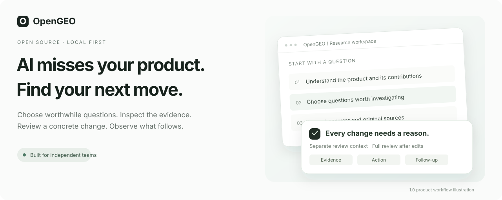
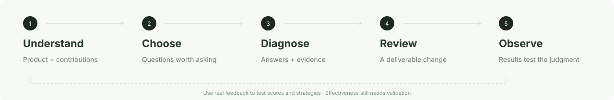

<div align="center">
<h1>OpenGEO</h1>
<p><strong>Turn "AI search can't find me" into evidence-backed improvements you can review and track.</strong></p>
<p><a href="#quick-start">Quick start</a> · <a href="#explore-opengeo">Explore the product</a> · <a href="#current-status">Current status</a> · <a href="README.md">中文</a></p>
</div>



*Development preview, actively evolving.*

People are asking questions your work can answer. **Do those answers lead them to you?**

OpenGEO brings worthwhile questions, real search evidence, improvement proposals, and follow-up observations into one local workspace for indie developers and small open-source teams. See where your work is being missed, then decide what to improve next.

## Explore OpenGEO

### 01 · Find questions worth asking

Every question needs a reason to exist. Start with two lines of inquiry: **what your product can solve** and **what your articles, research, and case studies contribute**. Find the people who could benefit from discovering your work. Assess whether a question is worth pursuing separately from how well you can answer it today.

The repository Skill supports investigation starting from a repository link, and the application supports question review. AI question drafting and review require a configured model.

### 02 · Follow the answers back to the evidence

See the original question, the engine's answer, cited sources, and measurement conditions together. Compare them with your existing material to understand whether the gap lies in content, evidence, or opportunities to be found.

Chinese and English questions are paired around the same need, with results kept separate. **Untested stays untested. A single missing result does not prove a page is unindexed.**

### 03 · Put every improvement through review

Proposals are reviewed in an independent context. Each quality dimension must meet its threshold; a high overall score cannot override a blocking issue. Revisions receive a complete new review, and manual edits invalidate the previous review.

**First, check that a proposal is ready to use. Then use real outcomes to test that judgment.**

## Five steps for one improvement



| Step | What it should deliver |
| --- | --- |
| **Understand** | Product capabilities, existing contributions, scope, and sources. |
| **Choose questions** | Questions with a target audience, a use case, and a reason to pursue them. |
| **Diagnose** | Real answers, sources featuring competitors, and evidence-backed findings about gaps. |
| **Review** | Specific changes, their rationale, quality checks, and a validation method. |
| **Observe** | Implementation records and follow-up measurements using the same questions and conditions. |

The Skill and application support different parts of this workflow. **A single link that automatically runs all five steps is still a development goal.**

You decide what to implement and when to enable follow-up collection. Follow-up measurements use the frozen question list and search conditions; your device and local service must stay online. Evidence-backed strategy records can inform later tasks, but whether they improve real outcomes still needs validation.

## Current status

The code includes question drafting and review, saved search results and evidence, answer analysis, competitor comparisons, improvement proposals with independent review, implementation records, and local SQLite storage. Page-specific Agent prompts and parameters are documented in [skills/README.md](skills/README.md).

Repository investigation remains a separate workflow and is not connected to the application. Project-wide optimization is still in development and is excluded from this public version. Daily scheduling code is included, but this release has not been verified by waiting for a real scheduled run. ChatGPT and Google web results have no automatic collection. Passing internal review does not establish improved visibility, visits, or conversions.

The public version contains two empty example projects. It includes no personal projects, search history, historical evidence, or validation reports.

## Quick start

You need Node.js and npm. The repository's Docker build uses **Node 24.5**.

```sh
git clone https://github.com/cooleryu/opengeo.git
cd opengeo
npm install
cp .env.example .env.local
npm run dev
```

Open **[localhost:4327](http://127.0.0.1:4327)**.

- **Explore first:** leave credentials empty to browse the two empty example projects and page structure.
- **Add your material:** edit the project details and assets in [example-project.json](src/lib/geo/data/example-project.json) or [example-project-two.json](src/lib/geo/data/example-project-two.json). Preserve their structure and project IDs. There is currently no in-app project creation or material import, and repository investigation output is not imported automatically.
- **Run a real workflow:** configure search services and an analysis model in Settings, or use the variables in [.env.example](.env.example). Saving settings makes no provider request. Connection tests, question drafting, searches, analysis, and review may incur charges. DeepSeek search and the analysis model are configured separately; a search budget is not a cap on all model calls.

See the [settings contract](docs/API/opengeo/pages/settings.md), [question-monitoring contract](docs/API/opengeo/pages/question-monitoring.md), and [API directory](docs/API/OPENGEO-CONTRACTS.md) for configuration, integrations, and charging behavior.

## FAQ

<details>
<summary><strong>Does it automatically collect answers from every AI platform?</strong></summary>

The main search interface supports DeepSeek search and Qwen and Doubao connected answers, with configured providers available for selection. Daily question schedules currently support DeepSeek only. Availability depends on configuration and provider service; no paid verification or real-time scheduled-run verification was performed for this release. ChatGPT and Google web results have no automatic collection, and no historical observations are bundled. ChatGPT subscription access supports selected analysis operations; it does not collect ChatGPT web search results. Follow-up collection must be explicitly enabled.

</details>

<details>
<summary><strong>Will it automatically publish improvements for me?</strong></summary>

No. You review the proposal, decide whether to implement it, and record your changes. Editing a reviewed draft requires a new review. Passing internal review does not prove real-world effectiveness.

</details>

<details>
<summary><strong>Can I start with just a repository, without preparing a pile of material?</strong></summary>

The [repository topic-discovery Skill](skills/repository-topic-discovery/SKILL.md) starts from a repository link and actively investigates the product and its existing contributions. Its investigation and the application workflow are not yet connected into a fully automatic process. E-commerce, companies, and individual creators remain planned scenarios in the [scenario specification](skills/SCENARIOS.md).

</details>

<details>
<summary><strong>Where are my API keys and search evidence stored?</strong></summary>

API keys stay in local configuration. Business records and newly collected evidence stay in the application data directory. Search and model calls send the necessary requests to your configured providers. The public source contains no personal records, credentials, or historical evidence. See the [settings contract](docs/API/opengeo/pages/settings.md) and [storage guide](docs/API/opengeo/storage.md).

</details>

## Build OpenGEO with us

**Bring a discovery problem worth solving.** [Open an issue](https://github.com/cooleryu/opengeo/issues/new) with the question, platform, language, date, and what you hoped to find. Remove private information before sharing.

Contributions are welcome in question quality, tested collection integrations, content and source governance, and comparable follow-up measurements. **Star the repository to follow its progress.**

---

Built on [Vane](https://github.com/ItzCrazyKns/Vane), reusing its Next.js foundation, model adapters, and SQLite storage while preserving the upstream [MIT license and copyright notice](LICENSE). Review and observation concepts also draw on a source review of [GEOFlow](https://github.com/yaojingang/GEOFlow); the related implementation here is independent.

Maintained by [cooleryu](https://github.com/cooleryu).
