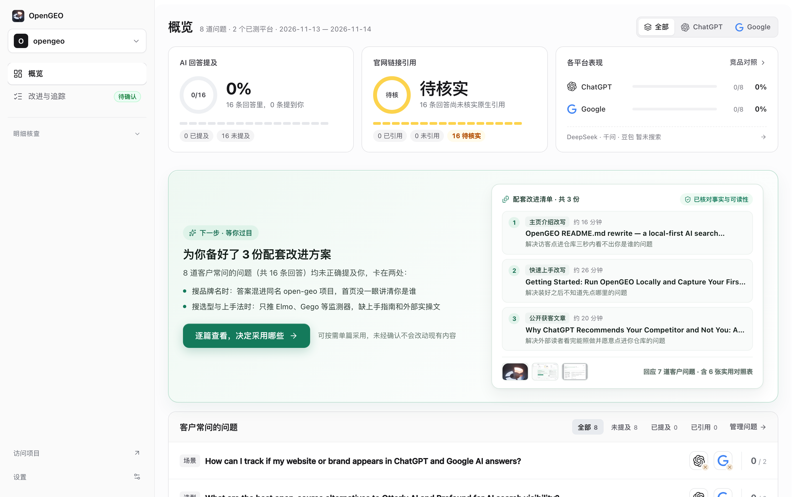
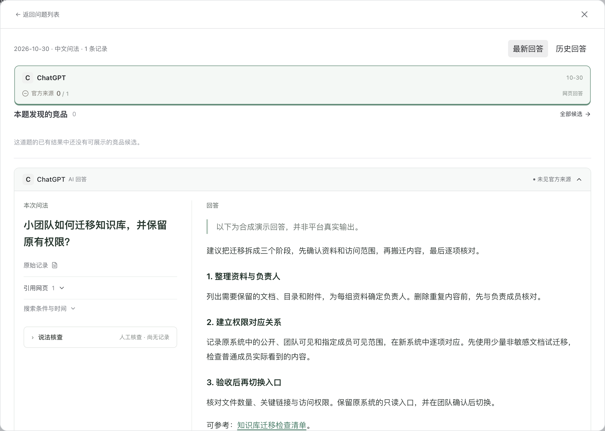
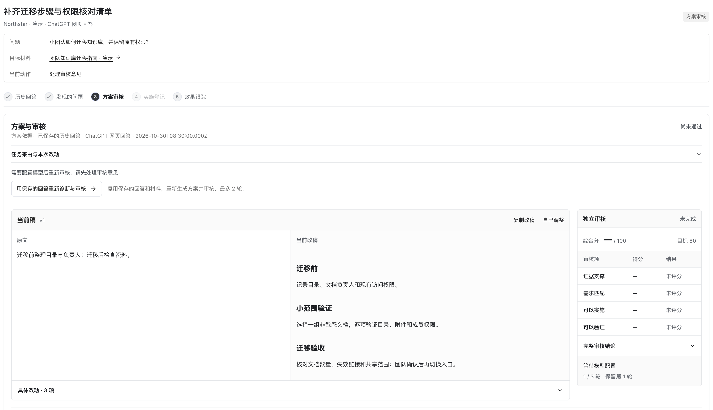

<div align="center">
<h1>OpenGEO</h1>
<p>People ask ChatGPT, DeepSeek, and other AI search engines about your brand, product, or open-source repository. The answer doesn't mention you, or gets you wrong — and you can't see who it cited or what to change.</p>
<p>OpenGEO asks those questions for real, saves the full answers and citations, shows who was mentioned and whose content was cited, and turns the gap into one concrete improvement.</p>
<p>Open source, runs locally. Every conclusion links back to the original answer — not a black-box score.</p>
<p><a href="#inspect-answers-and-citations">Features</a> · <a href="#supported-platforms">Platforms</a> · <a href="#quick-start">Quick start</a> · <a href="README.md">中文</a></p>
</div>



*Overview · Chinese interface, illustrative data*

Brand mentions and citations of your own content are counted separately. Untested, unknown, and confirmed zero results remain distinct. Open the underlying answer to check the evidence.

## Inspect answers and citations

Manage questions in Chinese and English, then read full answers, cited pages, and past results. Choose one main competitor and compare results for the same question, language, and platform.



*Answer details · Chinese interface, illustrative data*

## Turn gaps into improvement tasks

Generate a proposal from one question's evidence, review it independently, record implementation, and collect follow-up results under saved conditions. You decide whether to implement a proposal and enable follow-up collection.



*Improvements and tracking · Chinese interface, illustrative data*

## Supported platforms

| Platform | Current support |
| --- | --- |
| DeepSeek Search API | Collect web search results |
| Qwen API / Doubao API | Collect web-enabled answers and provider-supplied citations |
| ChatGPT / Google web | Display saved records; automatic collection is not connected |

API answers with web access may differ from answers in consumer apps. Search and analysis require connected services and may incur charges.

## Quick start

You need **Node.js 24** and npm:

```sh
git clone https://github.com/cooleryu/opengeo.git
cd opengeo
npm install
cp .env.example .env.local
npm run dev
```

Open [localhost:4327](http://127.0.0.1:4327). Leave credentials empty to browse two empty example projects. The illustrative data in the screenshots is not included.

Next: [add project material and connect services](docs/getting-started.md#english).

This is a development release with improvements for individual questions. Project-wide optimization is still in development. The app does not publish content automatically, and passing review does not establish improved traffic or conversions.

[API documentation](docs/API/OPENGEO-CONTRACTS.md) · [Agent guide](skills/README.md) · [Issues and suggestions](https://github.com/cooleryu/opengeo/issues/new)

---

Built on [Vane](https://github.com/ItzCrazyKns/Vane), preserving the upstream [MIT license and copyright notice](LICENSE). Proposal review and follow-up design draw on a source review of [GEOFlow](https://github.com/yaojingang/GEOFlow); the related implementation here is independent.

Maintained by [cooleryu](https://github.com/cooleryu).
