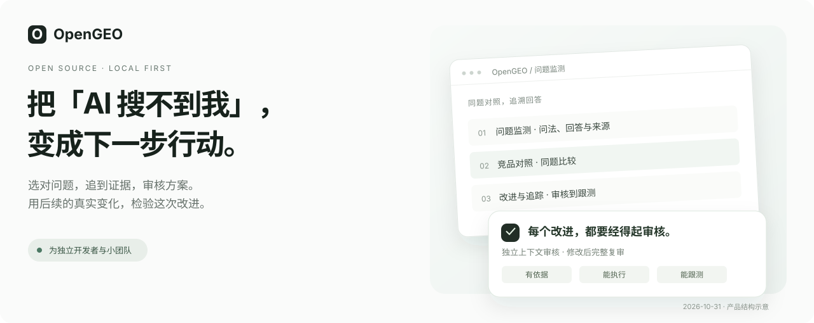
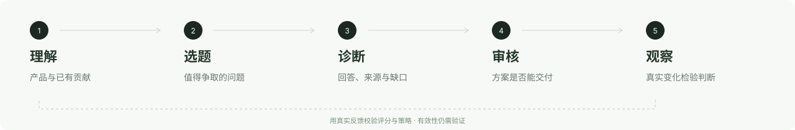

<div align="center">
<h1>OpenGEO</h1>
<p><strong>把「AI 搜不到我」，变成有依据、可审核、能跟踪的改进。</strong></p>
<p><a href="#开始使用">开始使用</a> · <a href="#看看-opengeo">看看产品</a> · <a href="#当前进度">当前进度</a> · <a href="README.en.md">English</a></p>
</div>



*1.0 产品预览，持续完善中。*

别人正在问你能解决的问题。**这些回答，有没有把他们带到你这里？**

OpenGEO 面向独立开发者与小型开源团队，把值得搜索的问题、真实搜索证据、改进方案与后续观察放在同一个本地工作台里。看清哪里没被发现，再决定下一步改什么。

## 看看 OpenGEO

### 01 · 先找到值得问的问题

每道问题，都需要一个存在的理由。沿着**产品能解决什么**和**已有文章、研究、案例贡献了什么**两条线，找到适合发现你的人。把“值得争取”与“现在能回答到哪里”分开判断。

仓库 Skill 支持从仓库链接开始调查，应用承接题单审阅。AI 拟题与审核需配置模型。

### 02 · 顺着回答，找到背后的证据

问题怎么问、引擎怎么答、引用了谁、在什么条件下测到，放在一起看。对照已有内容，才知道缺的是内容、证据，还是发现机会。

同一需求配成中英问法，分开保存结果。**没测过就标未测；一次没出现，不直接断言未收录。**

### 03 · 每个改进，都要经得起审核

方案在独立上下文中接受审核。各项质量要达到门槛，综合高分不能抵消阻断问题；修改后完整复审，手动改稿也会使旧审核失效。

**方案先过交付门槛，再让真实效果反过来检验判断。**

## 一项改进，串起五环



| 环节 | 应该交付什么 |
| --- | --- |
| **理解** | 产品能力、已有贡献、适用边界和来源。 |
| **选题** | 有人群、有使用情境、有争取理由的问题。 |
| **诊断** | 真实回答、竞品来源，以及有依据的缺口判断。 |
| **审核** | 具体改动、理由、质量检查和验证方法。 |
| **观察** | 实施记录与同题、同条件的后续测量。 |

Skill 和应用分别承接这条链路的不同部分。**“只给一个链接，全自动跑完五环”仍是开发目标。**

是否实施、何时启用跟测由你决定。后续观察沿用冻结的题单与搜索条件，设备和本地服务需保持在线。带证据的策略记忆可供后续任务参考，但它能否改善真实结果，仍需验证。

## 当前进度

持续高速更新中。

**2026 年 10 月 30 日，发布 1.0 完整正式版本。**

**绝对超乎你的想象。**

## 开始使用

准备 Node.js 和 npm。仓库的 Docker 构建使用 **Node 24.5**。

```sh
git clone https://github.com/cooleryu/opengeo.git
cd opengeo
npm install
cp .env.example .env.local
npm run dev
```

打开 **[localhost:4327](http://127.0.0.1:4327)**。

- **先看看：** 凭据留空，可以浏览已有样例和本地材料演示。
- **运行真实工作流：** 按 [OPENGEO.md](OPENGEO.md) 配置 DeepSeek 搜索凭据与诊断/审核模型。搜索与模型调用分别计费。

## 常见问题

<details>
<summary><strong>所有 AI 平台都能自动采集吗？</strong></summary>

目前公开版支持 DeepSeek 真实搜索。ChatGPT、Google、Gemini 是已保存的观测，尚未接入这些产品的自动采集。后续采集默认关闭，需要明确启用。

</details>

<details>
<summary><strong>它会自动替我发布改进内容吗？</strong></summary>

不会。你审阅方案、决定实施，并登记改动。修改已审核的稿件，需要重新审核。内部通过，也不代表真实效果已经得到证明。

</details>

<details>
<summary><strong>我能只给一个仓库，不准备一堆材料吗？</strong></summary>

[开源仓库选题 Skill](skills/repository-topic-discovery/SKILL.md)以仓库入口为起点，主动调查产品与已有贡献。它的调查工作与应用工作流，尚未连成全自动链路。电商、公司和个人创作者等场景仍在 [场景规范](skills/SCENARIOS.md)中规划。

</details>

<details>
<summary><strong>密钥和搜索证据放在哪里？</strong></summary>

密钥保存在本地配置，新采集的证据保存在本地；搜索和模型调用会向你配置的服务商发送必要请求。原工作区的完整历史证据不随源码分发，缺失的证据会如实显示不可用。详情见 [配置与工作流说明](OPENGEO.md)。

</details>

## 一起把 OpenGEO 做好

**带着一个值得解决的发现问题来。** 欢迎[提交 Issue](https://github.com/cooleryu/opengeo/issues/new)，告诉我们问法、平台、语言、日期，以及你期待找到什么；分享前请移除私人信息。

选题质量、经过测试的采集入口、内容与来源治理、可比较的跟测，都是欢迎参与的方向。**点个 Star，关注后续进展。**

---

基于 [Vane](https://github.com/ItzCrazyKns/Vane) 构建，复用 Next.js 基础、模型适配器与 SQLite 存储，保留上游 [MIT 许可证及版权](LICENSE)。审核与观察思路也参考了对 [GEOFlow](https://github.com/yaojingang/GEOFlow) 的源码研究，相关实现独立完成。

由 [cooleryu](https://github.com/cooleryu) 维护。
