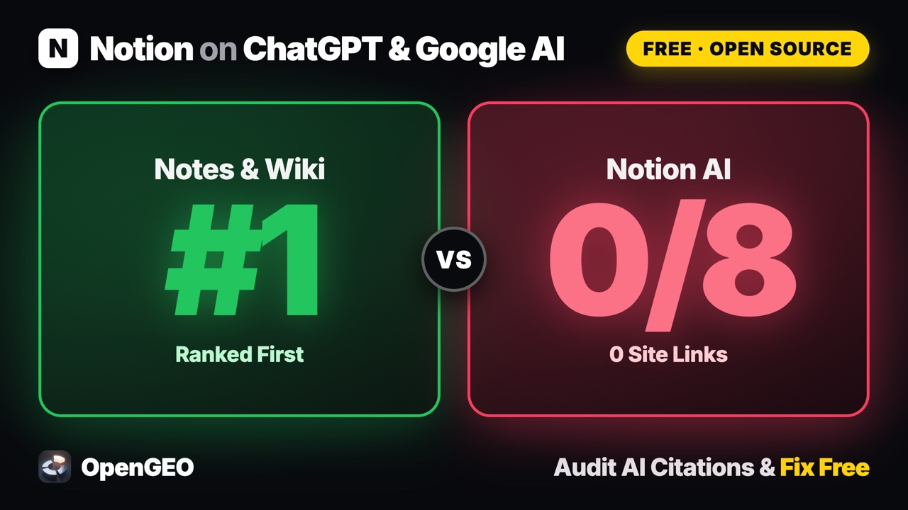
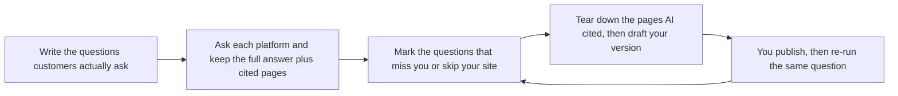
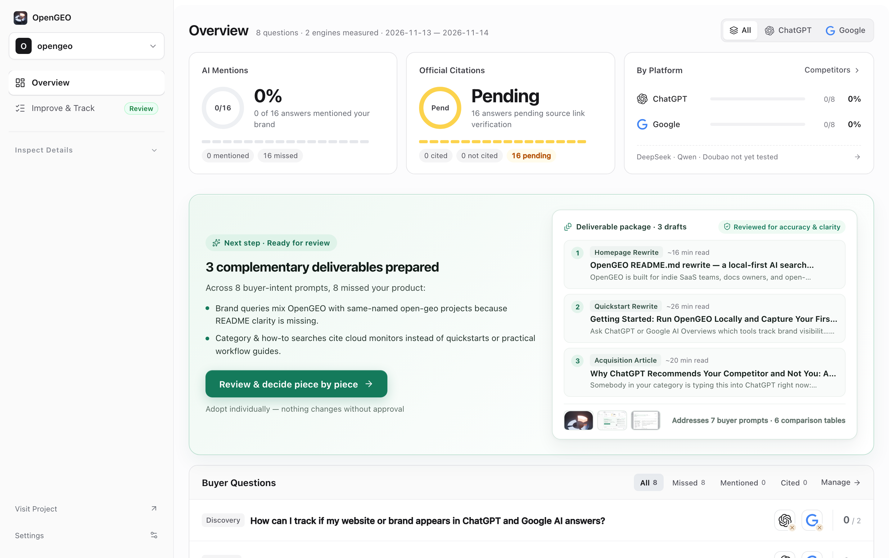
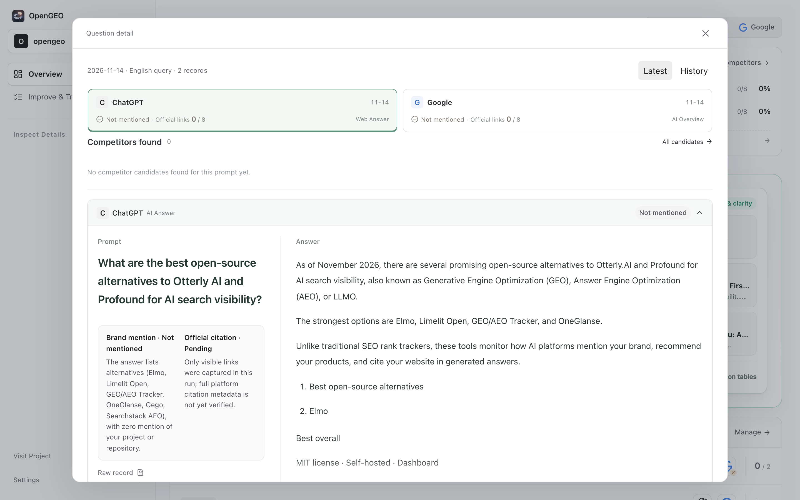
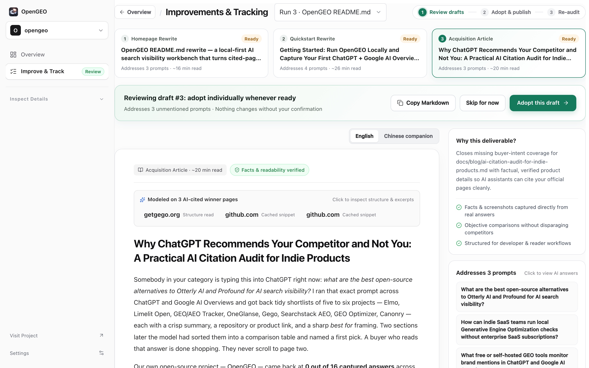

<div align="center">

<p align="center"></p>

# OpenGEO

### See how AI search answers for your product — then turn the gaps into better content.

**ChatGPT recommends a competitor and never mentions you. Google AI Overviews gets your features wrong. The answer cites three roundup posts and never links your site.**<br>
Run the questions your customers actually type, keep the full answers and every page they cite,<br>
find the gaps, draft the rewrite, and re-run the same questions after you ship.

OpenGEO is an open-source, local-first AI search visibility workbench. It captures real ChatGPT and Google AI Overview answers from your own browser, counts brand mentions and cited pages as two separate numbers, compares one question against your competitors, and re-runs the same questions after you ship.

It is MIT licensed and runs on your own machine: no subscription, no seat pricing, no hosted account. Everything it captures stays in a local SQLite database and files on your disk, and the only cost is what your own model provider charges for the queries you run with the API key you configured. Start it locally with Node.js 24 — see Quick Start below.

**[Live Demo](https://www.opengeo-ai.workers.dev)** · **[90s Video (YouTube)](https://youtu.be/Dj8AopJg6SY)** · **[Compare vs Profound / Otterly / Peec](docs/comparisons/profound-otterly-ai-peec-ai-alternatives.md)** · **[Is OpenGEO for you](#is-opengeo-for-you)** · **[Quick Start](#quick-start)** · **[How it works](#how-it-works)** · **[Features](#features)** · **[Documentation](#documentation)** · **[Privacy & Cost](#privacy--cost)** · **[简体中文](README.zh-CN.md)**

</div>

<p align="center">
  <a href="https://youtu.be/Dj8AopJg6SY">
    
  </a>
  <br />
  <em>▶ <a href="https://youtu.be/Dj8AopJg6SY">Watch the 90-second walkthrough on YouTube</a> — live Notion audit (#1 for notes, 0/8 on ChatGPT &amp; 0/16 site links) + dogfooding OpenGEO on this repo.</em>
</p>

## Is OpenGEO for you?

OpenGEO is built for indie SaaS teams, docs owners, and open-source maintainers who need citation-level evidence — which page the model picked, what the answer actually said, and what to change next — rather than one more visibility score to watch. Someone in your category is asking AI for a recommendation right now, and the answer is being assembled from pages that may not be yours. If you can't see which pages those are, you can't compete for them.

- **Every conclusion links back to the original answer.** Who was mentioned, which page was cited — the saved answer text and the source URL sit in the same view. If it isn't in the captured answer, it doesn't count as a mention.
- **It writes the draft, not just the advice.** Each gap comes with several complementary drafts and a before/after comparison, so there is something to publish when the round ends.
- **Adopt one draft at a time.** Review each one and adopt only what fits. Nothing is published automatically, and anything you skip leaves your live pages untouched.
- **Your data, questions, and keys stay on your machine.** Project details, saved answers, and API keys never leave your computer, and you choose which model provider to use.

### How it differs from other GEO tools

| What you're comparing | Where it stops | What OpenGEO adds |
| --- | --- | --- |
| Hosted visibility dashboards (Otterly.AI, Profound, Peec AI) | A monthly subscription and a visibility score with a trend line | The same question set, but every finding opens the saved answer and the exact pages it cited |
| Self-hosted trackers & scrapers (Elmo, Gego, Limelit Open, OneGlanse, GEO/AEO Tracker) | Either call model APIs instead of the live consumer UI, or rely on heavy Docker / paid-scraper stacks that stop at monitoring scores | It captures the real ChatGPT and Google AI Overview result inside your own browser session, keeps the full answer text, and stores every cited URL |
| Page auditors and linters (robots.txt, llms.txt, schema checks) | They report what's missing on your own pages | It reads the pages AI already cites for that question, compares their structure with yours, and then drafts the version that fills the gap |
| Engine coverage | Scheduled trackers sweep dozens of engines and hand you a score per engine | It stays on the two consumer surfaces that actually cite pages today — ChatGPT and Google AI Overview — and keeps the full answer text for each one |
| Traffic and conversion context | A visibility score that sits apart from your analytics | The traffic screen keeps referral sources, Umami, and article conversions in the same project as the mentions and citations |

**It plugs into the workflow you already run.** Captured answers, cited pages, and competitor lists sit in a local SQLite database and plain files on your disk, not behind an account. `docs/API/OPENGEO-CONTRACTS.md` documents the data shapes and the endpoints each screen uses, so you can read results into your own scripts; `npm run collect` runs a collection round from the terminal if you'd rather not open the UI. OpenGEO is meant to sit beside your existing SEO stack, not replace it — your rank tracker and crawler keep doing their job, and this fills in the layer they can't see: which pages AI actually cited for a question.

**Probably not a fit if** you only want hundreds of keywords scanned on a schedule with a weekly report waiting for you — no API key to connect, no answers to save by hand. A paid hosted monitoring service is less effort there. If what you need is to see whose pages AI actually cites, keep that evidence on your own disk, and walk away with a draft, OpenGEO is the right tool.

## Quick Start

**1 · Launch the workbench.** Send the repository URL `https://github.com/cooleryu/opengeo` to the AI coding assistant you already use — Claude Code, Cursor, Codex, and Antigravity all work — and ask it to follow the repo's instructions, start the app locally, and open it for you; it handles the setup steps along the way. Prefer to do it yourself, or want to know what each screen is for first? Read [Quick Start](docs/getting-started.md).

**Run it yourself:** Node.js 24 and npm, nothing else — no Docker, no server. From the repository root:

```bash
npm install
npm run dev
```

Then open http://127.0.0.1:4327.

**2 · Create a project and a question list.** First launch opens the new-project screen: pick a project type, paste your public homepage, add a couple of notes. Once OpenGEO understands the product, it proposes the question categories customers usually ask, and you can refine or add the exact English prompts buyers actually ask.

**3 · Capture a round, pick drafts, re-test.** After the first round, see which questions leave you out. Review each draft and adopt only the ones that fit. Once a draft is live, register it in the workbench (or push repo docs straight from the studio) and re-run the same question later — both records sit on one timeline, so the change is visible.

## How it works

One loop: questions go in, evidence comes out, drafts come out, and the same questions get checked again. Everything produced along the way is stored locally, and you can reopen any of it later.





*Overview screen — brand mentions and website citations tracked separately, with diagnosis summary and per-question audit rows*

## Features

### Question monitoring with the source evidence attached

Track your core buyer questions across ChatGPT and Google AI Overviews in one list. A round runs the list you saved and records four things per question: brand mentions, citations of your own pages, your primary competitor's mentions on that same question, and the delta against the previous round. The answer detail keeps the question as phrased, the full saved answer, and every page it cited, with your domain flagged in that list. Untested, unknown and a true zero are shown as separate states, so an empty cell never reads as a lost mention. Set a primary competitor and compare the same question and platform line by line; after you publish and register a draft as live, re-test the original question to see what moved.

| On the answer detail screen | What it settles |
| --- | --- |
| The question exactly as asked | The same wording every round, so a change means something |
| The full saved answer | You can check a claim yourself instead of trusting a score |
| Every cited page with its URL | Which outside pages are winning that question today |
| Your domain vs. your competitor's, same question | Which gap is yours to fix and which one belongs to the category |



*Question detail — inspect the full answer captured from Google or ChatGPT alongside every competitor named instead of you*

### Winner teardown, drafts with before/after, and per-draft adoption

When a question misses you, OpenGEO first reads the pages AI cited for it — their heading order, how they open, what they cover that you don't — then writes several complementary drafts instead of three versions of the same paragraph. Each draft puts your current text and the proposed text side by side and passes a fixed three-point review before it reaches you. You adopt what you like, publish it yourself, register it as live, and re-test the original question later. Nothing is published without your confirmation.



*Action Plan — read each draft in full, compare before/after edits, view companion translations when enabled, and publish one piece at a time*

### Supported platforms

| Platform | How OpenGEO gets the answer | What you can verify |
| --- | --- | --- |
| ChatGPT, Google AI Overviews | Runs your question list one-click inside your own local browser session at a slow, human-like pace | The answer a real logged-in user sees, plus every cited page and URL. If Google throws a human-verification check mid-batch, it pauses for you to clear it and resumes cleanly |
| Private / incognito window (manual fallback) | Ask the exact prompt in an incognito window and paste the full answer plus cited URLs | Preserves the exact wording and cited references in the same project library for auditing and before/after comparison |

Different browser sessions can surface slightly different answers, and Google AI Overviews don't appear for every query. OpenGEO judges on the copy you actually captured, so a round reflects what was really served that day instead of a normalized average.

Google's AI Overview and AI Mode are two different surfaces. The table above covers the AI Overview shown above the regular results; the AI Mode conversational tab is not collected in this version.

Gemini, Perplexity, Copilot and other engines have no integration here, and no release date is promised for them. For those, use the manual fallback: ask the prompt yourself and paste the full answer with its cited links.

## Documentation

| Document | Contents |
| --- | --- |
| [Quick Start](docs/getting-started.md) | Setup, first project, first round of questions, first re-test |
| [API Contracts](docs/API/OPENGEO-CONTRACTS.md) | Data contracts and endpoints per screen — start here if you want to build on top of OpenGEO |
| [Agent Prompts](skills/README.md) | How the built-in agent proposes questions, diagnoses gaps, and writes drafts |
| [简体中文](README.zh-CN.md) | Chinese version of this page |

## Privacy & Cost

Project details, saved answers, and the API keys you enter live only on your own machine; this repository uploads none of them to any server. There is no monthly fee, no seat price, and no hosted account — the fixed cost is $0. Money only moves when you send live queries: one question in a round is one live call to the model provider you configured, so a round of N questions is N calls at that provider's rates, plus whatever your search service charges. Reading saved answers and comparing them across runs makes no calls and stays free. A cheap way to start: run three to five questions to see whether the gap is real, then add the rest of the round only if it is.

## Feedback & Maintenance

Hit a bug, want another platform supported, or have an opinion about a screen? Open an issue at [Issues & Suggestions](https://github.com/cooleryu/opengeo/issues/new) — a saved answer or a screenshot makes it far easier to reproduce.

Maintained by [cooleryu](https://github.com/cooleryu).

OpenGEO is maintained at github.com/cooleryu/opengeo and is not affiliated with Pupok462/open-geo, opengeo.work, the OpenGEO browser extension, or OSGeo OpenGeo Suite.
