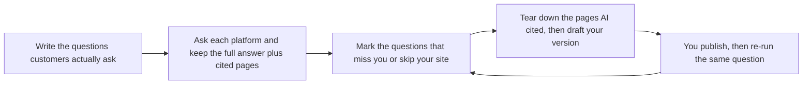

# OpenGEO

### See how AI search answers for your product — then turn the gaps into better content.

**ChatGPT recommends a competitor and never mentions you. DeepSeek gets your features wrong. The answer cites three roundup posts and never links your site.** 
Run the questions your customers actually type, keep the full answers and every page they cite, 
find the gaps, draft the rewrite, and re-run the same questions after you ship.

OpenGEO is an open-source, local-first AI search visibility workbench: it captures real ChatGPT and Google AI Overview answers from your own browser, 
shows who got named and whose pages got cited, then turns each gap into one draft you can publish.

**[Is OpenGEO for you](#is-opengeo-for-you)** · **[Quick Start](#quick-start)** · **[How it works](#how-it-works)** · **[Features](#features)** · **[Documentation](#documentation)** · **[Privacy & Cost](#privacy--cost)** · **[简体中文](README.zh-CN.md)**

## Is OpenGEO for you?

OpenGEO is built for indie SaaS teams, docs owners, and open-source maintainers who need citation-level evidence — which page the model picked, what the answer actually said, and what to change next — rather than one more visibility score to watch. Someone in your category is asking AI for a recommendation right now, and the answer is being assembled from pages that may not be yours. If you can't see which pages those are, you can't compete for them.

- **Every conclusion links back to the original answer.** Who was mentioned, which page was cited — the saved answer text and the source URL sit in the same view. If it isn't in the captured answer, it doesn't count as a mention.
- **It writes the draft, not just the advice.** Each gap comes with several complementary drafts and a before/after comparison, so there is something to publish when the round ends.
- **Adopt one draft at a time.** Review each one and adopt only what fits. Nothing is published for you, and anything you skip leaves your live pages untouched.
- **Your data, questions, and keys stay on your machine.** Project details, saved answers, and API keys never leave your computer, and you choose which model provider to use.

### How it differs from other GEO tools

| What you're comparing | Where it stops | What OpenGEO adds |
| --- | --- | --- |
| Hosted visibility dashboards (Otterly.AI, Profound, Peec AI) | A monthly subscription and a visibility score with a trend line | The same question set, but every finding opens the saved answer and the exact pages it cited |
| Self-hosted API trackers (Elmo, Gego, Limelit Open, GEO/AEO Tracker) | They call provider APIs, so you get the API's answer rather than the page a logged-in user sees, and the output is mostly a mention or citation list | It captures the real ChatGPT and Google AI Overview result inside your own browser session, keeps the full answer text, and stores every cited URL |
| Page auditors and linters (robots.txt, llms.txt, schema checks) | They report what's missing on your own pages | It reads the pages AI already cites for that question, compares their structure with yours, and then drafts the version that fills the gap |

**Probably not a fit if** you only want hundreds of keywords scanned on a schedule with a weekly report waiting for you — no API key to connect, no answers to save by hand. A paid hosted monitoring service is less effort there. If what you need is to see whose pages AI actually cites, keep that evidence on your own disk, and walk away with a draft, OpenGEO is the right tool.

## Quick Start

**1 · Launch the workbench.** Send the repository URL `https://github.com/cooleryu/opengeo` to the AI coding assistant you already use — Claude Code, Cursor, Codex, and Antigravity all work — and ask it to follow the repo's instructions, start the app locally, and open it for you; it handles the setup steps along the way. Prefer to do it yourself, or want to know what each screen is for first? Read [Quick Start](docs/getting-started.md).

**2 · Create a project and a question list.** First launch opens the new-project screen: pick a project type, paste your public homepage, add a couple of notes. Once OpenGEO understands the product, it proposes the question categories customers usually ask, and you can add your own in English or Chinese.

**3 · Capture a round, pick drafts, re-test.** After the first round, see which questions leave you out. Review each draft and adopt only the ones that fit. Once a draft is live, register it in the workbench and re-run the same question later — both records sit on one timeline, so the change is visible.

## How it works

One loop: questions go in, evidence comes out, drafts come out, and the same questions get checked again. Everything produced along the way is stored locally, and you can reopen any of it later.

## Features

### Question monitoring with the source evidence attached

English and Chinese questions live in one list. Pick your platforms, run a round, and the answer detail shows the question as phrased, the full answer text, and every page it cited, with your domain flagged in that list. Set a primary competitor and compare the same question, same language, same platform line by line.

| On the answer detail screen | What it settles |
| --- | --- |
| The question exactly as asked | The same wording every round, so a change means something |
| The full saved answer | You can check a claim yourself instead of trusting a score |
| Every cited page with its URL | Which outside pages are winning that question today |
| Your domain vs. your competitor's, same question | Which gap is yours to fix and which one belongs to the category |

### Winner teardown, drafts with before/after, and per-draft adoption

When a question misses you, OpenGEO first reads the pages AI cited for it — their heading order, how they open, what they cover that you don't — then writes several complementary drafts instead of three versions of the same paragraph. Each draft puts your current text and the proposed text side by side and passes a fixed three-point review before it reaches you. You adopt what you like, publish it yourself, register it as live, and re-test the original question later. Nothing is published automatically.

### Supported platforms

| Platform | How OpenGEO gets the answer | What you can verify |
| --- | --- | --- |
| ChatGPT, Google AI Overviews | Runs your question list inside your own logged-in browser session at a slow, human-like pace; you can also save an answer by hand from a private window | The answer a real logged-in user sees, plus every cited page and URL. If Google throws a human-verification check mid-batch, you clear it yourself and the run continues |
| DeepSeek, Qwen, Doubao | Add your own API key; OpenGEO asks online and stores the raw response | The full answer text plus whatever citations the provider returns |

API answers can differ from what you see in the mobile app, and Google AI Overviews don't appear for every query. OpenGEO judges on the copy you actually captured, so a round reflects what was really served that day instead of a normalized average.

## Documentation

| Document | Contents |
| --- | --- |
| [Quick Start](docs/getting-started.md) | Setup, first project, first round of questions, first re-test |
| [API Contracts](docs/API/OPENGEO-CONTRACTS.md) | Data contracts and endpoints per screen — start here if you want to build on top of OpenGEO |
| [Agent Prompts](skills/README.md) | How the built-in agent proposes questions, diagnoses gaps, and writes drafts |
| [简体中文](README.zh-CN.md) | Chinese version of this page |

## Privacy & Cost

Project details, saved answers, and the API keys you enter live only on your own machine; this repository uploads none of them to any server. Reading existing records and comparing past answers costs nothing. Costs only appear when you actively send a live query, generate drafts, or run a re-test — the workbench then calls the model and search providers you configured, and their normal usage rates apply based on which provider you chose and how many questions are in the round.

## Feedback & Maintenance

Hit a bug, want another platform supported, or have an opinion about a screen? Open an issue at [Issues & Suggestions](https://github.com/cooleryu/opengeo/issues/new) — a saved answer or a screenshot makes it far easier to reproduce.

Maintained by [cooleryu](https://github.com/cooleryu).

OpenGEO is maintained at github.com/cooleryu/opengeo and is not affiliated with Pupok462/open-geo, opengeo.work, the OpenGEO browser extension, or OSGeo OpenGeo Suite.
