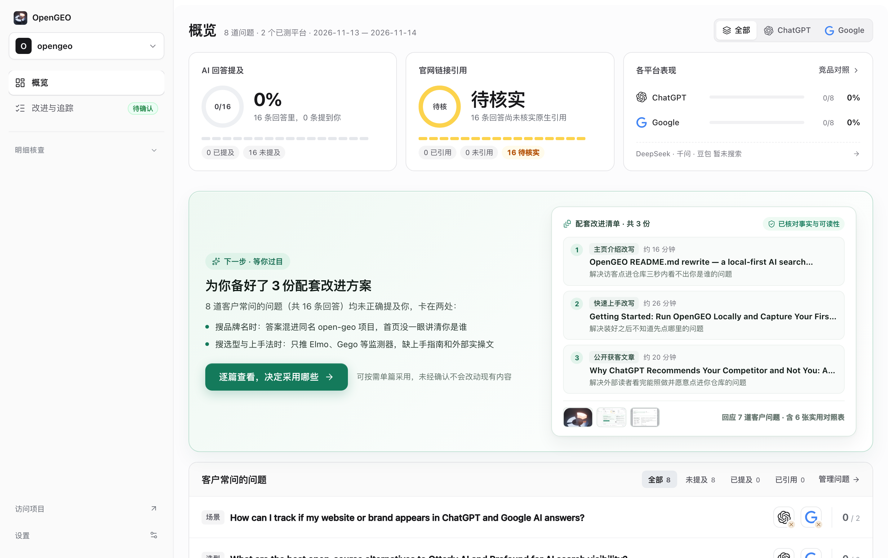
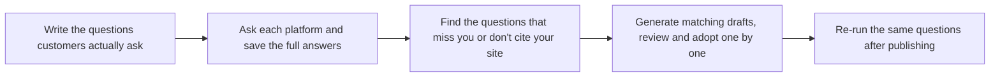
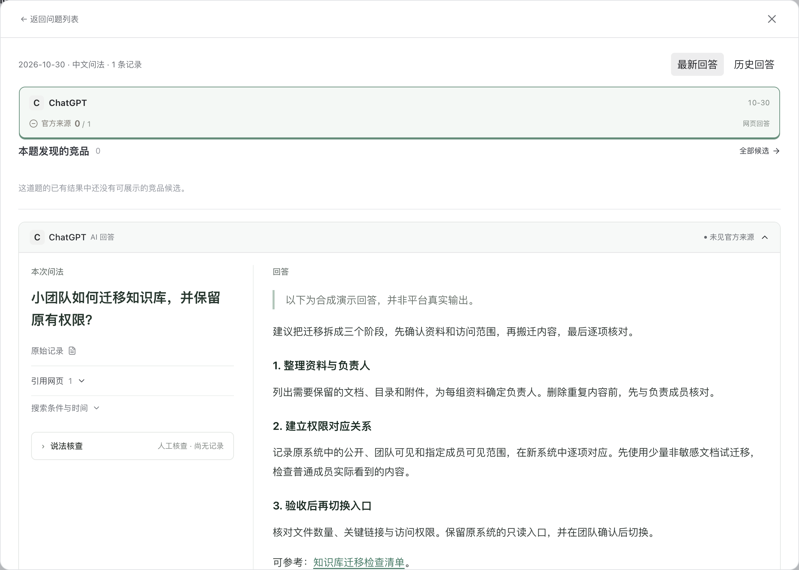
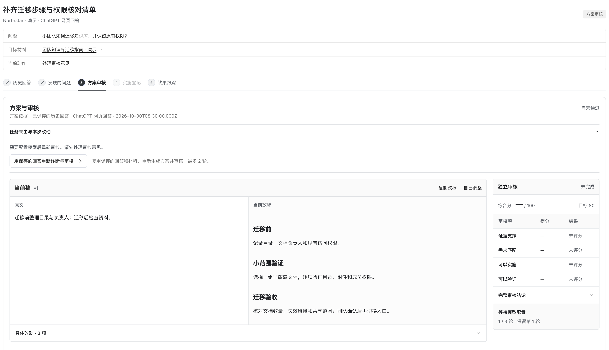

# OpenGEO

### See how AI search answers for your product — then turn the gaps into better content.

**ChatGPT recommends a competitor and never mentions you. DeepSeek gets your features wrong. The answer lists no link to your site.** 
Run real customer questions through AI search, keep the full answers and cited pages, 
find the weak spots, write matching drafts, and re-check the same questions once you ship.

OpenGEO is an open-source, local-first AI search visibility workbench: ask real user questions in AI search, 
see who gets mentioned and whose content gets cited, then turn each gap into one actionable improvement.

**[Is OpenGEO for you](#is-opengeo-for-you)** · **[Quick Start](#quick-start)** · **[How it works](#how-it-works)** · **[Features](#features)** · **[Documentation](#documentation)** · **[Privacy & Cost](#privacy--cost)** · **[简体中文](README.zh-CN.md)**

*Overview screen · demo data (real results depend on your project and the platforms you've tested)*

## Is OpenGEO for you?

Most AI search monitoring tools hand you a "visibility score" and a trend line. The number goes up or down, and you still don't know which page or which paragraph to fix next week. OpenGEO takes a different angle: it lays out every answer in full, together with the pages it cited, so "what to change" becomes something you can act on directly.

- **Every conclusion links back to the original answer.** Who was mentioned, which page was cited — the text and the source link are right there. If it doesn't line up, it wasn't mentioned.
- **It writes the matching draft, not just advice.** For each gap it finds, it generates a concrete content plan, with before and after side by side.
- **Adopt drafts one at a time, no forced bulk publishing.** Review each draft and adopt only the ones that fit. Anything you don't adopt leaves your live content untouched.
- **Your data, questions, and keys stay on your machine.** Project details, saved answers, and the API keys you enter never leave your computer, and you choose which model to use.

**Probably not a fit if** you only want hundreds of keywords scanned automatically on a schedule and a ready-made weekly trend report out of the box — without connecting an API or manually saving answers from the web UI. A paid hosted monitoring service will be less effort there. If what matters more is understanding whose pages AI actually cites, keeping the data in your own hands, and getting the draft written along the way, OpenGEO is the right match.

## Quick Start

**1 · Launch the workbench**
Send the repository URL `https://github.com/cooleryu/opengeo` to the AI coding assistant you already use (Claude Code, Cursor, Codex, or Antigravity all work) and let it follow the repo's instructions to run the app locally and open it for you — it handles dependency installation and local configuration along the way. If you'd rather do it yourself, or want to see what each screen is for first, open [Quick Start](docs/getting-started.md).

**2 · Create a project and a question list**
The first launch takes you to the new-project screen: pick a project type, paste your public homepage URL, and add a few notes. Once it understands your product, it prepares the question categories customers usually ask, and you can add your own questions in Chinese or English.

**3 · Collect answers, pick drafts, re-test**
After the first round, see which questions leave you out. Review each generated draft and adopt only the ones that fit. Once you've published, re-run the same questions later — both records stay together so the change is visible.

## How it works

The loop is short: questions go in, evidence comes out, drafts come out, and the same questions get checked again. Everything produced along the way is stored on your own machine and you can go back to it at any time.

## Features

### Question monitoring with source evidence

Manage Chinese and English questions in one place. Pick your platforms, run a round, and the answer detail shows side by side: how the original question was phrased, the full AI answer, and every page it cited. Whether your domain appears among the cited rows is visible at a glance. Choose a primary competitor and compare line by line on the same question, language, and platform.

*Answer detail · demo data: who was mentioned in this question, and which sites the cited pages came from*

### Improvement plans with per-draft adoption

For each gap it finds, OpenGEO plans several complementary drafts at once instead of rewording the same point. Each draft has a before-and-after comparison, and you register it once you've confirmed it's live. Later, re-check with the original question — both records sit on the same timeline. The workbench never publishes anything automatically; you review the draft, and you publish it.

*Improvement tracking · demo data: which draft was adopted and what changed before and after re-testing*

### Supported platforms

| Platform | How you get the answer | What you can verify |
| --- | --- | --- |
| DeepSeek / Qwen / Doubao | Add your own API key; the workbench queries online and saves the response | The full answer text, plus the cited pages and links the provider returns |
| ChatGPT / Google | You ask on the web, then save the real answer you saw into the workbench | The exact answer you saw, checked line by line against the sources it lists |

Answers returned by an API may differ from what you see in the mobile app. The workbench judges based on the copy you actually captured.

## Documentation

| Document | Contents |
| --- | --- |
| [Quick Start](docs/getting-started.md) | Full steps from setup to connecting services and running your first round of questions |
| [API Contracts](docs/API/OPENGEO-CONTRACTS.md) | Data contracts and API reference — start here to build on top of OpenGEO |
| [Agent Prompts](skills/README.md) | Prompt structure and rewriting approach of the built-in agent |
| [简体中文](README.zh-CN.md) | Chinese version of this page |

## Privacy & Cost

Project details, saved AI answers, and the API keys you enter live only on your own machine. This repository uploads none of them to any server. Browsing existing records and comparing past answers costs nothing. Only when you actively send a live query, generate an improvement plan, or run a re-test does the workbench call the model and search services you chose — and that incurs the corresponding usage fees, depending on which provider you use and how many questions you run per round.

## Feedback & Maintenance

Found a problem, want support for a new platform, or have an idea for the UI? Open an issue at [Issues & Suggestions](https://github.com/cooleryu/opengeo/issues/new) — a screenshot or a saved answer makes it much easier to pin down.

Maintained by [cooleryu](https://github.com/cooleryu).

OpenGEO is not affiliated with opengeo.work, the OpenGEO browser extension, or OSGeo OpenGeo Suite.
