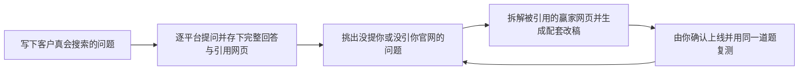

# OpenGEO

### 看清 AI 搜索怎么回答你的产品，把缺口改成能上线的好内容。

**ChatGPT 推荐了竞品却没提你，DeepSeek 把你的功能说岔了，回答底下引了好几篇合集贴偏偏没有你官网。** 
把客户真会打出来的问法在 AI 搜索里跑一遍，完整存下回答原文和挂出来的参考网页， 
拆解赢家页面怎么写的，对照原稿直接写出配套改稿，上线后再回原题复测变化。

OpenGEO 是一个开源、本地运行的 AI 搜索可见性工作台：在你自己的浏览器会话里采集真实的 ChatGPT 与 Google AI Overview 回答， 
分清「提到品牌」和「引用官网」，再把每处差距写成一篇可以直接审阅采用的改稿。

**[适合你吗](#opengeo-适合你吗)** · **[快速开始](#快速开始)** · **[工作方式](#工作方式)** · **[核心功能](#核心功能)** · **[文档](#文档)** · **[隐私与费用](#隐私与费用)** · **[English](README.md)**

## OpenGEO 适合你吗？

市面上大多数 AI 可见性工具最后给你一个「曝光得分」和一条走势线。数字上下波动，但下周到底该改官网哪一页、哪一段，你依然无从下手。OpenGEO 写给独立 SaaS 团队、文档负责人和开源作者看：我们把每一次真实回答原文和模型引用的网页摊开，让你先看到赢家凭什么被选中，再决定下一篇内容改什么。

- **每条结论都挂回原始回答核对**：正文里提没提到品牌、来源里引没引到官网，各自独立判定，点开就能看到回答原文与 URL；正文没写就不算「已提及」。
- **不仅给诊断建议，直接交付配套改稿**：针对缺口先去读取真正被引用的外部网页结构，再一次规划 1～3 篇互补改稿，改前改后同屏对照。
- **按篇单独采用，不强迫批量发布**：每篇都经核对把关，由你逐篇决定「采用」或「暂不采用」；不采用的稿件绝不改动仓库或线上内容。
- **项目资料、回答原文与接口密钥留在本地**：所有数据存在本机目录，仓库不上传任何隐私，用哪家模型也完全由你指定。

### 与其他 GEO 工具的区别

| 你在对比的方案 | 它停在哪里 | OpenGEO 多做了什么 |
| --- | --- | --- |
| 按月订阅的云端看板（Otterly.AI、Profound、Peec AI） | 收月费，给出一份按题统计的曝光趋势与声量评分 | 同样跑核心问题清单，但每条结论都能点回保存的完整回答与具体引用网址 |
| 自托管 API 监测器（Elmo、Gego、Limelit Open、GEO/AEO Tracker） | 通过接口提问，拿到的是 API 返回而不是真实登录用户在网页端看到的界面，结果也偏统计列表 | 在你自己的浏览器会话里采集真实的 ChatGPT 与 Google AI Overview 回答，完整保存原文并抽出全部引用网址与竞品 |
| 页面规则检查工具（robots.txt、llms.txt、Schema 校验） | 只告诉你自家页面缺了哪些技术标签 | 直接去读模型已经引用的高排名网页骨架，对比你的页面缺口后直接起草可发布的新版本 |

**不太适合的情况**：如果你只需要每天自动巡检上百个关键词、开箱直接收趋势周报，不希望配置自己的接口密钥，也不想在网页端补录回答，按月付费的托管平台会省事得多。如果你更在乎搞清楚 AI 到底引了谁的网页、证据留在自己手里、并且顺手拿到改稿，OpenGEO 更合拍。

## 快速开始

**1 · 启动工作台**：把仓库地址 `https://github.com/cooleryu/opengeo` 发给你平时在用的 AI 编程助手（Claude Code、Cursor、Codex 或 Antigravity 都行），让它按仓库说明帮你在本地装好依赖、配置环境并打开页面。如果你更想自己操作，或者想先看清每个界面做什么，直接看 [快速上手指南](docs/getting-started.zh-CN.md)。

**2 · 建好项目与核心问题清单**：首次打开先在表单顶部选好界面语言（中文或英文），选择项目类型（开源项目 / 软件或网站），贴入公开首页链接并写几句定位说明。工作台读完公开页后会自动推导出客户常问的几类问题，并精选最多 8 道核心题；你可以随时增删改中英文问法。

**3 · 采一轮回答、审改稿、原题复测**：跑完第一轮后，看清哪些问题漏掉了你；展开配套改稿对照原稿审阅，只采用合适的；内容上线后回来登记并过阵子拿同一道题、同一个入口再问一次，前后两次记录留在同一条时间线上。

## 工作方式

整个闭环只有四步：问题进去，真实回答与引用出来，拆解赢家结构后写出改稿，上线再用原题复查。中间每份证据与草稿都留在你的电脑上。

*概览界面 — 品牌提及与官网引用分开呈现，中间卡片直观汇总待办改进突破口，下方列表逐题可回溯原文*

## 核心功能

### 问题监测与逐题原文留证

中英文问题放在同一份清单里管理。跑完一轮后，点开任意一道题，回答详情里并排呈现「本次问法原句」、「AI 完整回答正文」、「抽出的竞品名单」以及每个条目的来源判定。把某家竞品设成主要对照，同一道题、同一种语言、同一个平台之间一眼分清差距来源。

| 回答详情里的每一栏 | 帮你拍板的事 |
| --- | --- |
| 本次问法原句 | 每次复测保持一字不差，变化才说明改写真的生效 |
| 完整回答原文 | 正文提没提品牌按原文核验，不再盲信评分表 |
| 所有引用网页与竞品名单 | 看清今天到底是谁的哪几篇文章赢下了这道题 |
| 与竞品同题对照 | 分清是「整个品类没人做这题」，还是「竞品某篇踩中了结构」 |

*回答详情 — 点开任意一道监测题，同时查看 Google 与 ChatGPT 的真实回答正文以及同题被推荐的竞品*

### 赢家网页拆解、改前改后对照与单篇采用

发现某道题漏掉你后，OpenGEO 会先探测模型真正引用的外部页面——拆解它们用什么 H2 标题、首段怎么下定义、对比表怎么排——随后一次规划 1～3 篇角度互补的改稿，而不是把同一句话换着词写三遍。每篇展开都可对比「修改前原文」与「修改后新稿」，还可按需查看中文对照版本用于核对或中文平台另发；工作台绝不替你私自发布任何内容。

*改进与追踪 — 逐篇审阅英语原稿与中文对照版，确认后再单独采用或把仓库文档一键同步到 GitHub*

### 支持的平台

| 平台 | 采集方式 | 你能核对到的证据 |
| --- | --- | --- |
| ChatGPT、Google AI Overview | 在你自己的已登录浏览器会话里按接近真人的节奏跑完问题清单；也支持在无痕窗口手动问完把回答贴回来 | 真实登录用户看到的完整回答正文、提及情况与提取出的引用来源；若 Google 中途弹出人机验证，交回给你本人手动通过后继续 |
| DeepSeek、千问、豆包 | 填入你自己申请的接口密钥，工作台直接联网提问并保存 | 完整回答正文及服务商返回的参考来源链接 |

不同入口返回的答案并不总是一致（例如 API 与手机 App 就常有出入）。工作台一律按你这一轮真正采到的那一版原件做判断，因此前后复测只要守住同一入口就有参考价值。

## 文档

| 文档 | 内容 |
| --- | --- |
| [快速上手指南](docs/getting-started.zh-CN.md) | 从装好服务、创建项目、跑第一轮回答到原题复测的完整步骤 |
| [接口与数据契约](docs/API/OPENGEO-CONTRACTS.md) | 各个界面的数据结构与本地接口说明，适合做二次开发时查阅 |
| [Agent 提示词说明](skills/README.md) | 内置 Agent 如何生成问题、诊断差距并撰写改稿 |
| [English README](README.md) | 本页面的英文版 |

## 隐私与费用

项目资料、采集下来的 AI 回答、以及你填写的模型和搜索接口密钥都只保存在你自己的电脑上，这个仓库不会把它们上传到任何第三方服务器。平时翻看历史回答、对比前后记录、阅读改稿本身不花钱；只有当你主动发起产品分析、联网提问、生成改进方案或原题复测时，工作台才会用你自己的密钥向所选服务商发请求并产生对应账单。

## 反馈与维护

使用中遇到问题、想增加新平台支持、或者对某个页面交互有建议，欢迎直接在 [Issues & Suggestions](https://github.com/cooleryu/opengeo/issues/new) 提出来，附上截图或保存的回答原文会更好定位。

由 [cooleryu](https://github.com/cooleryu) 维护。

OpenGEO 仓库位于 github.com/cooleryu/opengeo，与 Pupok462/open-geo、opengeo.work、同名 Chrome 扩展及 OSGeo OpenGeo Suite 无隶属关系。
