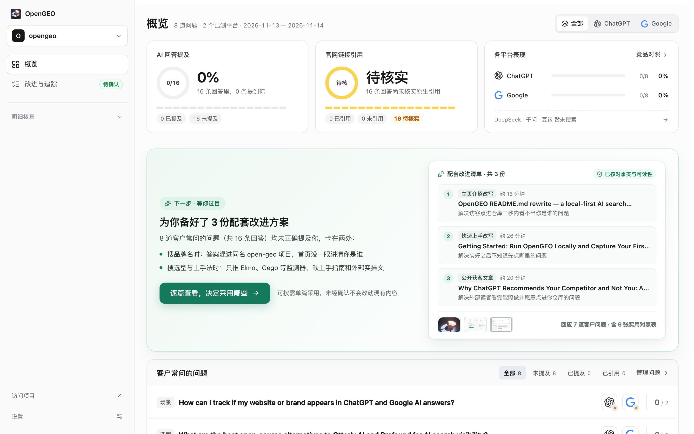
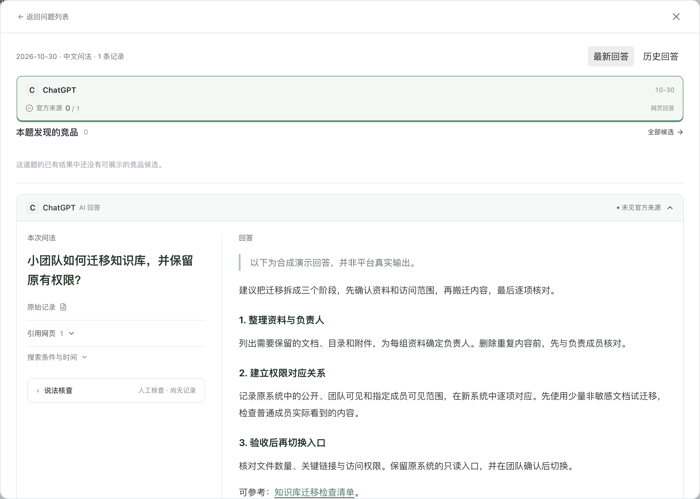
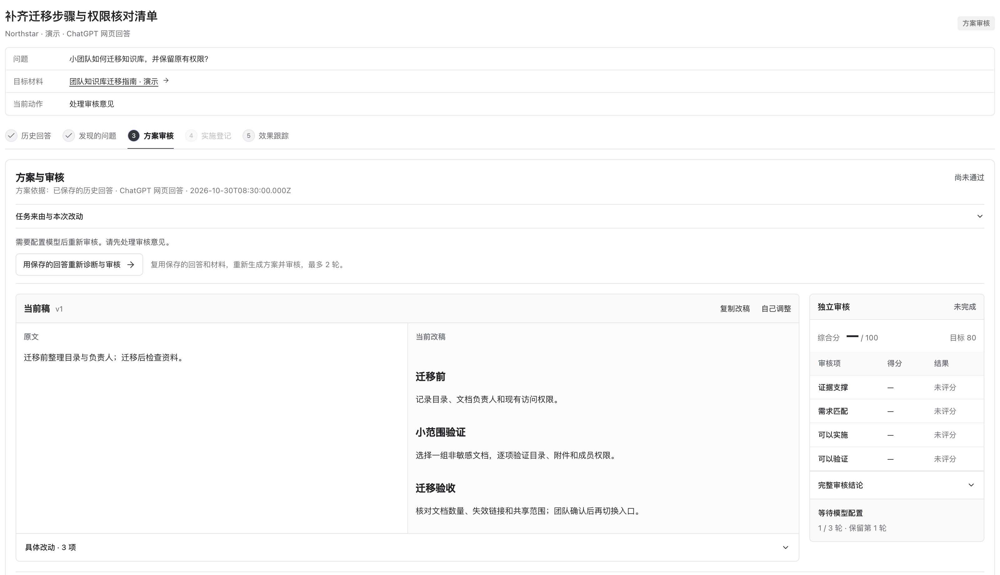

# OpenGEO

### 看清 AI 搜索怎么回答你的产品，把缺口改成好内容。

**ChatGPT 推荐了竞品没提你、DeepSeek 说错了你的功能、回答底下没挂你的官网。** 
把真实客户问题在 AI 搜索里跑一遍，存下完整回答和参考网页， 
查到短板直接写出配套改稿，挑合适的上线后再用原题复查变化。

OpenGEO 是一个开源、本地运行的 AI 搜索可见性工作台：把真实用户问题在 AI 搜索里问一遍， 
看清谁被提及、谁的内容被引用，再把差距变成一条可执行的改进。

**[适合你吗](#opengeo-适合你吗)** · **[快速开始](#快速开始)** · **[整体流程](#整体流程)** · **[功能](#功能)** · **[文档](#文档)** · **[隐私与费用](#隐私与费用)** · **[English](README.md)**

*概览界面 · 演示数据（实际结果取决于你的项目和已测的平台）*

## OpenGEO 适合你吗？

多数 AI 搜索监测工具最后交给你的是一个「可见度得分」加一条趋势线。分数涨了跌了，你还是不知道下周该改哪一页、哪一段。OpenGEO 换个方向：把每一次回答原文和它挂出来的参考网页摊在你面前，让「改什么」变成能直接动手的事。

- **每条结论都能点回原始回答核对**：提到了谁、引用了哪个网页，都有原文和来源链接摆着，对不上就是没提到。
- **直接写好配套改稿，不只是给建议**：围绕查出来的短板生成能落地的内容方案，改前改后放在一起比。
- **按篇单独采用，不绑架全发**：一篇篇看，觉得对路的才采用；不采用的，线上内容保持原样。
- **数据、提问和密钥都留在自己电脑上**：项目资料、保存的回答、你填的接口密钥不出本地，用哪个模型也由你定。

**不太适合的情况**：如果你只想要每天定时自动扫上百个关键词、开箱就拿到趋势周报，既不想连接口也不想手工把网页端的回答补录进来，那么按月付费的线上监测服务会省心得多。如果你更在意搞清楚 AI 到底引了谁的网页、数据想攥在自己手里、还想顺手把改稿做出来，那 OpenGEO 正好对口。

## 快速开始

**1 · 启动工作台**
把仓库地址 `https://github.com/cooleryu/opengeo` 发给你常用的 AI 编程助手（Claude Code、Cursor、Codex、Antigravity 都可以），让它照着仓库里的说明帮你在本地把页面跑起来并直接打开，依赖安装、本地配置这些它会一并处理。想自己动手、或者想先看看每个界面是干嘛的，进 [快速上手文档](docs/getting-started.zh-CN.md)。

**2 · 创建项目与提问清单**
第一次打开会进到新建项目页：选项目类型，贴入公开主页链接，再写几句补充说明。系统读懂你的产品之后，会把客户常问的那几类问题准备好，你也可以自己加中英文问题。

**3 · 采回答、挑改稿、再复测**
跑完这一轮，看清哪几道题里漏了你；逐篇审阅生成的配套改稿，只采用觉得对上路的；发布上线后隔段时间拿原题重测一次，前后记录留在一起，变化看得见。

## 整体流程

工作台的闭环很短：问题进去，证据出来，改稿出来，再拿原题复查一轮。中间每一步产生的东西都存在你自己的电脑里，随时能翻回去看。

## 功能

### 问题监测与原文留证

中英文问题统一管理，选好平台跑一轮，就能在回答详情里并排看到：原始提问怎么写、AI 的完整回答是什么、它挂出来的参考网页有哪些。引用网页那几行里你的域名在不在，一眼能看到。挑一个主要竞品，还能按同题、同语言、同平台做逐条对照。

*回答详情 · 演示数据：能看出这道题里提到了谁、参考网页来自哪个站点*

### 配套改进方案与单篇采用

针对查出来的短板，一次规划几篇互补的改稿，而不是把同一个说法换几个词重复。每篇都有改前改后的对照，你确认落地了再登记；过阵子用原问题复查，两次记录放在同一条时间线上。工作台不会自动发布任何内容，稿子最终由你看过、由你发出去。

*改进追踪 · 演示数据：能看出哪篇已采用、复查前后的变化*

### 支持的平台

| 平台 | 怎么拿到回答 | 你能核对到什么 |
| --- | --- | --- |
| DeepSeek / 千问 / 豆包 | 填上你自己申请的接口密钥，工作台自动联网提问并保存 | 完整回答正文，以及服务商返回的参考网页与链接 |
| ChatGPT / Google | 你在网页端问，把看到的那份真实回答保存进工作台 | 你实际看到的回答原文，和它列出的参考链接逐条对照 |

接口拿到的回答和你手机上看到的 App 回答可能不一样，工作台按你实际采到的那一份来判断。

## 文档

| 文档 | 内容 |
| --- | --- |
| [快速开始](docs/getting-started.zh-CN.md) | 从装好到连上服务、跑第一轮问题的完整步骤 |
| [接口文档](docs/API/OPENGEO-CONTRACTS.md) | 数据契约与接口说明，想二次开发或对接看这里 |
| [Agent 提示词说明](skills/README.md) | 内置 Agent 的提示词结构和改写思路 |
| [English README](README.md) | 本页的英文版 |

## 隐私与费用

项目资料、保存下来的 AI 回答、你填的接口密钥，都只存在你自己的电脑上，这个仓库不往任何服务器上传它们。翻看已有记录、对比历史回答不花钱。只有你主动发起联网提问、生成改进方案或做复测时，工作台才会去请求你自己选定的模型和搜索服务，产生对应的调用费用，花多少取决于你用哪家服务、一轮跑多少题。

## 反馈与维护

用着有问题、想加新平台支持、或者对界面有想法，直接去 [问题与建议](https://github.com/cooleryu/opengeo/issues/new) 开一条，附上截图或保存的回答更容易定位。

由 [cooleryu](https://github.com/cooleryu) 维护。

OpenGEO 与 opengeo.work、同名 Chrome 插件及 OSGeo OpenGeo Suite 无隶属关系。
