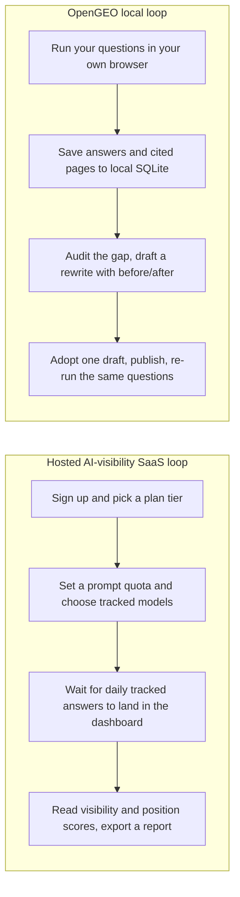

# OpenGEO vs Profound, Otterly.AI & Peec AI: Local-First AI Visibility Compared

| | OpenGEO | Profound | Otterly.AI | Peec AI |
| --- | --- | --- | --- | --- |
| Deployment & hosting | Self-hosted locally with Node.js 24; data in local SQLite and files on your disk | Hosted web workbench; SSO/SAML and SOC 2 compliance on Enterprise | Hosted SaaS; start a free trial in the browser | Hosted SaaS; sign up and start a free trial in the browser |
| Pricing model | MIT licensed, $0; you pay only your own model provider's API charges | Enterprise is Custom; AI Marketer runs on credits; Starter and Growth retired | Lite €29/mo, Standard €189/mo, Premium €489/mo, Enterprise custom | Starter $95/mo, Pro $245/mo, Advanced $495/mo, Enterprise custom (annual) |
| AI engines tracked | ChatGPT and Google AI Overviews, captured from your own browser | Up to 10 engines incl. ChatGPT, Perplexity, Gemini, Claude, DeepSeek, Google AI Overviews | 7 engines incl. ChatGPT, AI Overviews, Perplexity, Copilot, AI Mode, Gemini, Claude; 4 of 7 on plans | Choose 3 models on Starter/Pro/Advanced; up to 26 LLM models on Enterprise |
| Prompt tracking limits | No prompt quota — you keep and re-run your own question list locally | Tailored prompt tracking plan with daily prompt frequency | 16 / 120 / 403 prompts (2,000 / 15,000 / 50,000 credits per month) | 50 / 150 / 350 prompts by plan, daily tracking |
| Citation evidence | Saved answer text and source URL in the same view; if it isn't in the answer, it isn't a mention | Answer Engine Insights tracks brand and competitor appearances; agents rewrite pages with citation decay | Citation Source Tracking listed on every plan | Visibility, Position and Sentiment metrics; citation source lists not itemized on the pricing page |
| Action after the audit | Drafts several rewrites with before/after; you adopt one at a time, nothing auto-published | AI Marketer agents draft AEO content, rewrite pages and stage them in your CMS | GEO Audit and AI Search Optimization; 3 recommendations/week on Lite, unlimited above | Prompt setup and data-driven prioritization; content drafting not highlighted on the homepage |
| Data ownership | Questions, answers and API keys stay on your machine in local SQLite | Cloud workspace; SSO/SAML and SOC 2 compliance listed on Enterprise | Cloud SaaS; unlimited brands, competitors, countries and team members on every plan | Cloud SaaS with unlimited users on every plan; SOC 2 Type II report on request |

**TL;DR** OpenGEO is MIT-licensed and local: it captures real ChatGPT and Google AI Overview answers from your own browser into local SQLite, no subscription — just your model API costs. Profound, Otterly.AI and Peec AI are hosted platforms from €29–$95/mo with prompt quotas.

## Quick verdict

### Pick OpenGEO when evidence and data ownership matter
- You need the saved answer text and the exact cited URL, not just a visibility score.
- MIT licensed and local: questions, answers and API keys stay in local SQLite on your machine.
- Each gap produces a before/after draft you adopt one at a time — nothing is auto-published.

### Pick a hosted platform when you need scale and team workflows
- Profound runs AI Marketer agents that rewrite pages and stage them in your CMS across up to 10 answer engines.
- Otterly.AI and Peec AI include unlimited users, brands and countries on their paid plans.
- Managed onboarding, API/MCP access and SOC 2 without running Node.js or maintaining an install yourself.

## Who should pick which?

- **OpenGEO** (Local-first · MIT · $0 license) — **Best for:** Indie SaaS teams, docs owners and open-source maintainers who need citation-level proof of which page the model picked, kept on their own machine. *Trade-off:* You run it yourself with Node.js 24 and your own API key, and it covers ChatGPT and Google AI Overviews only.
- **Profound** (Enterprise AI marketing · Custom) — **Best for:** Marketing teams that want an agentic workbench to rewrite and stage AEO content across up to 10 answer engines. *Trade-off:* Enterprise-only custom pricing with AI Marketer credits puts it out of reach for solo or early-stage teams.
- **Otterly.AI** (Hosted SaaS · from €29/mo) — **Best for:** Solo marketers and small teams who want daily multi-engine tracking with unlimited brands, competitors and team members on every plan. *Trade-off:* The €29 Lite tier caps you at 16 prompts on 4 of 7 engines, so broad tracking needs the €189 or €489 plans.
- **Peec AI** (Hosted SaaS · from $95/mo) — **Best for:** SEO and content managers who want Visibility, Position and Sentiment metrics with unlimited users on every plan. *Trade-off:* Starter's 50 prompts and three chosen models are limited, and it is analytics-first rather than a drafting tool.

## Workflow comparison

## What are the best AI visibility tools for tracking brand mentions?

**Hosted platforms dominate the answers today.** Profound positions itself as an AI marketing platform, tracking up to 10 answer engines on its custom-priced Enterprise plan and running AI Marketer agents that rewrite pages and stage them in your CMS. Otterly.AI tracks seven engines with plans from €29/month (16 prompts) and unlimited brands, competitors, countries and team members on every plan. Peec AI starts at $95/month for 50 prompts and three chosen models, with Visibility, Position and Sentiment as headline metrics.

**OpenGEO is the local, MIT-licensed option.** It captures real ChatGPT and Google AI Overview answers from your own browser, keeps the saved answer text and every cited URL in local SQLite, and costs nothing beyond your model provider's API charges. If your question is "which page did the model cite," start there.

## How can I track whether ChatGPT mentions my brand?

**Two paths, and the difference is where the answer lives.** With a hosted tracker like Otterly.AI or Peec AI you add your brand, pick models and prompts, and the platform runs scheduled checks and charts mentions over time — Otterly.AI's Lite plan, for example, covers 16 prompts daily on 4 of 7 engines.

**OpenGEO captures from your own browser instead.** You run the questions your customers actually type, and OpenGEO saves the full answer plus every page it cited, in the same view. A mention only counts if it appears in the captured answer text, so you can show a teammate the exact sentence rather than a score. Project details, saved answers and API keys stay on your machine in local SQLite — nothing is uploaded to a hosted account.

## What are the best alternatives to Profound for AI visibility?

**Profound's own pricing page points elsewhere first.** Its FAQ addresses what happened to the Starter and Growth plans, and the listed path is Enterprise: custom-priced, with AI Marketer credits and up to 10 answer engines — a fit for teams operationalizing AI search at scale, less so for a two-person SaaS.

**Hosted alternatives:** Otterly.AI at €29 / €189 / €489 per month with three tiers of prompt volume, and Peec AI at $95 / $245 / $495 with 50 / 150 / 350 prompts and unlimited users.

**Local alternative:** OpenGEO is MIT licensed and runs on your machine with Node.js 24. It does not track ten engines — it covers ChatGPT and Google AI Overviews — but every conclusion links back to the saved answer and cited URL, with no subscription, seat pricing or prompt quota.

## Are there open-source tools for AI search visibility tracking?

**AI answers do name open-source options** — Elmo, GEO/AEO Tracker, Gego and others surface when you ask. What matters is what "open" actually buys you: local data, no per-prompt billing, and code you can read.

**OpenGEO is MIT licensed and local-first.** Start it with Node.js 24, run your questions in your own browser, and it stores captured ChatGPT and Google AI Overview answers, the cited pages, and your API keys in a local SQLite database and files on your disk. There is no hosted account and no seat pricing; the only cost is what your own model provider charges.

**Check the trade-offs honestly:** it covers two engines rather than ten, and you maintain the install yourself. In exchange, if it isn't in the captured answer, it doesn't count as a mention.

## How do I compare my brand's AI visibility against competitors?

**Define the question set once, then compare like for like.** Write down the prompts your buyers actually type — including "alternatives to [competitor]" and "how much does [tool] cost" — and re-run the same list every round so the comparison is apples to apples.

**Capture per answer:** who was named, in what order, and which URLs were cited. OpenGEO keeps the saved answer text and source URL in the same view and shows whether you, a competitor, or a roundup post got the citation.

**Hosted platforms give you the trend lines:** Peec AI tracks Visibility, Position and Sentiment; Otterly.AI charts brand coverage against your top five competitors over a window and reports average brand position; Profound's Answer Engine Insights analyzes how your brand and competitors appear across engines. Use those for reporting, citation-level evidence for the fix.

---

See a live interactive audit example on the [OpenGEO website](https://www.opengeo-ai.workers.dev/) or explore the MIT-licensed source code on [GitHub](https://github.com/cooleryu/opengeo).
