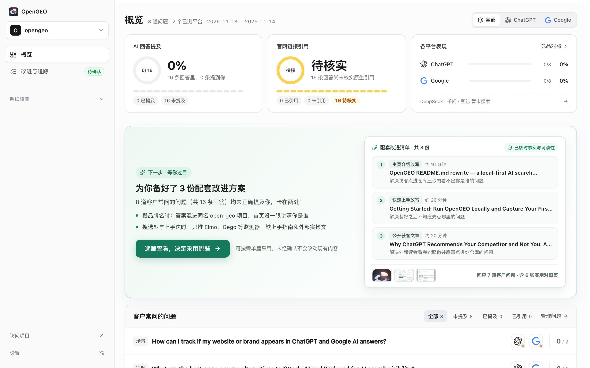
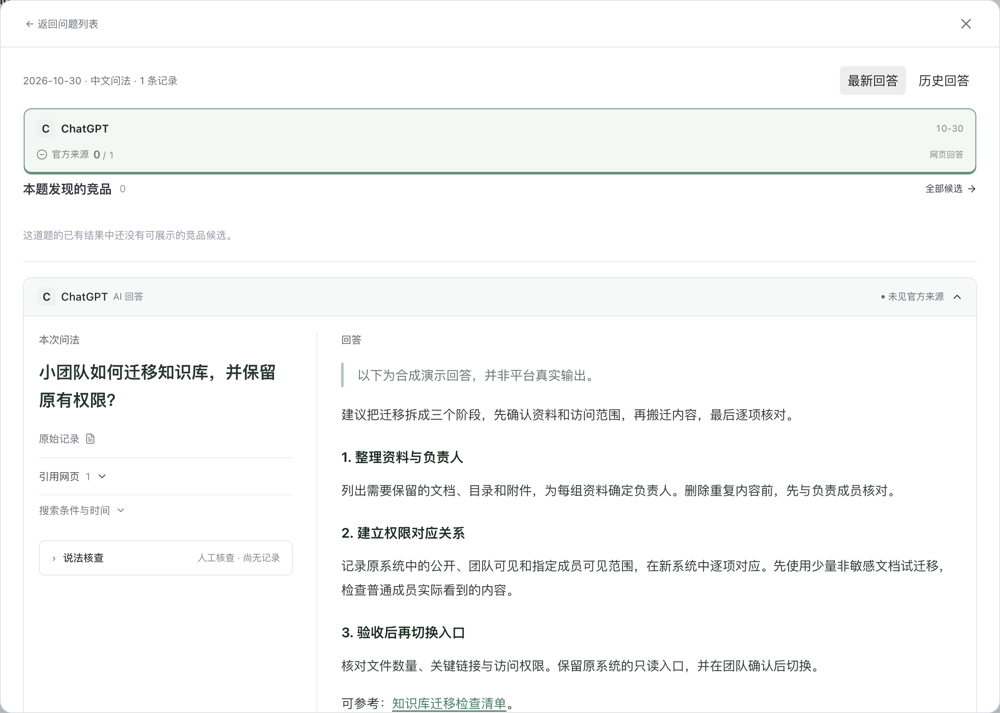
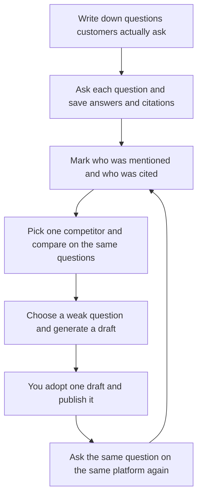
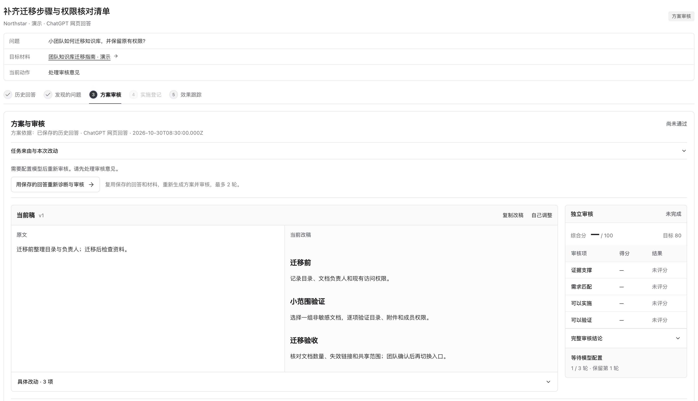

# Quick Start Guide

> **Language**: English · [简体中文](getting-started.zh-CN.md)

When you ask a business-related question in AI search products like ChatGPT, DeepSeek, or Doubao, the answer often lists a few products or a few web pages. You may not know whether your product is included, or whether the answer cites your official site or a competitor’s comparison article. Checking manually is also easy to skew by login state, memory, and personalization.

OpenGEO makes this repeatable: save the questions your customers actually ask as a list, ask them one by one, and keep the full answers and the links shown under those answers exactly as they appeared. Then mark who was mentioned and whose content was cited, and generate a publishable draft for the question that most needs improvement. It runs on your own computer. Project files, answer records, and API keys stay in local directories and do not pass through our servers.

## The big picture

Learn four terms first, and you’ll know what you’re looking at during every step.

| Concept | What it is | How you use it |
| --- | --- | --- |
| Your project profile | Your public website or repository homepage, plus a short description: who it serves, what problem it solves, and what makes it stronger than alternatives | Helps the workbench understand your product; question generation and draft writing both depend on this |
| Customer questions | How potential buyers search in AI for similar products, compare competitors, or search your brand name directly | Reuse one list so results are comparable before and after changes |
| Answer evidence | The full answer text saved after each question, plus the reference pages shown under it | Check conclusions against the original text instead of relying on memory |
| Suggested drafts and retesting | Publishable content written for a specific weakness; you choose whether to use it and then ask the same question again | Each change maps to an observable difference |

The loop has three steps: **create a project → collect and compare answers → adopt a suitable draft, publish it, and retest with the original question**.

A full round usually takes 30–60 minutes. You do not need to start with dozens of questions.

## 1 · Start the workbench and create a project

The easiest way to start: send the repository URL to the AI coding assistant you already use—Claude Code, Cursor, or Codex all work—and say, “Follow the instructions in this repo to install it locally and open the UI.” The repository URL is:

`https://github.com/cooleryu/opengeo`

It will read the instructions, install dependencies, start the service, and give you a local address. Open that address in your browser to reach the workbench. Answer its questions as they come; you do not need to know the command line.

Prefer to start from a terminal? (developer option)

See the “Getting Started” section in [the README](../README.md) for the full setup. You’ll need Node.js 24 and npm. After the steps are complete, open `http://127.0.0.1:4327` in your browser. Copy the environment variable template during that step; leave any missing keys blank for now and add them in the UI later.

The first screen is the new-project page. It has three steps:

1. **Choose a type**: open-source project / e-commerce store / company or product / creator. The type only affects the wording of generated questions. You can change it later.
2. **Add a public URL**: your website, repository homepage, or store page all work. Then add a few sentences about positioning—who uses it, what problem it solves, and what makes it stronger than similar products. These sentences directly affect how the workbench understands you, so it’s worth writing a little more.
3. **Click “Start analysis”**: it reads the public pages, shows you what it understood, and automatically derives and selects up to 8 core questions from a potential buyer’s perspective. If the understanding is off, or you want to add the exact phrases customers often use, edit them directly. You don’t have to invent questions from a blank page.

Some pages require login. Projects it cannot read are kept; retry with a publicly accessible URL.

When the project is created, you land on the **Overview** page. This page answers two things only: whether AI answers mention you, and whether the reference links under those answers include your site.

*The screenshot shows a demo project. Your new project starts from zero.*

## 2 · Connect services and collect real answers

Open **Settings** and enter API keys for models or search services you already have accounts for. There’s no pressure to configure everything. One working provider is enough for the first round.

| Platform | How to get answers | What you’ll see |
| --- | --- | --- |
| DeepSeek / Qwen / Doubao | Enter the API key and ask questions from the question list with one click | The full answer text and the source links returned by the platform |
| ChatGPT / Google AI answers | Avoid risky interception workarounds; ask in an incognito window yourself, then paste the answer text and reference pages into the matching question | Recorded in the same project as API results, with mentions and citations counted together |

Both kinds of results go into the same project, and the numbers on the Overview page are combined. When pasting, include the full answer text and links, not just one sentence—later checks for “did it cite me?” depend on that original text and those links.

**Optional: choose one main competitor for comparison.** Looking at the same set of questions on the same platform side by side immediately separates two different situations: no one in the category was mentioned for this question, or a specific competitor page was cited while yours was not. The first case means you need more content. The second means you should examine the angle they wrote from.

*Screenshot contains demo data.*

After one round, new answers appear directly in the Overview. For the first pass, run the core questions prepared automatically when you created the project (up to 8 questions) on one or two commonly used platforms to see the direction. Don’t try to cover everything at once.

## 3 · Review drafts and retest with the original questions

When the Overview shows a clear weakness—for example, “none of the category-recommendation questions mentioned us, and the answers cited three competitor comparison articles”—open **Improvements & Tracking**. The top of the page lists a few complementary proposals: one adds a factual page to your official site, and another writes third-party-style comparison content. You can pick just one. Each expands to compare the **new draft** with the **original text**.

The drafts don’t force you to publish everything at once. If a draft looks right, click **Adopt this draft**. If you don’t want to act yet, click **Not adopting for now** and come back in a couple of weeks.

After the content goes live, return to the same question, use the same platform and the same entry point, and ask again. The two answers sit side by side, so you don’t have to guess what changed.

*Screenshot contains demo data.*

## Cost and local data

- Reviewing past answers, changing settings, and reading drafts are free.
- The workbench only sends requests to the corresponding services with your own keys when you actively click product analysis, online questions, draft generation, or retesting. You pay the provider’s official prices in your own account. One question asked once costs one Q&A call; leaving it idle does not keep increasing spend.
- Keys, login state, and the project database live in local directories on your computer, not on our servers. Be careful not to commit these files to public repositories.
- Stopping the local service does not lose data; start it again and continue where you left off. When the service is not running, the UI cannot open.

## FAQ

### Can I try it without any API keys?

Yes. ChatGPT and Google answers are collected by asking manually and pasting the answer and evidence, so you can record the first batch of answers and analyze mentions and citations without any keys. Keys are needed for three things: running DeepSeek, Qwen, and Doubao with one click in the UI; letting the model understand your project profile; and automatically generating drafts.

### The same question gives a different answer through an API than in the mobile app. Did I do something wrong?

This is common. API retrieval switches, result counts, memory, and personalization settings are not the same as those in consumer apps, so the same model can legitimately give different answers through different entry points. The most useful comparison is longitudinal: the same question, the same entry point, asked once before and once after a change. Comparing numbers across entry points easily leads to wrong conclusions.

### How does this compare with paid monthly monitoring tools like Peec, Otterly, or Ahrefs?

They solve two halves of the same problem: online platforms help you watch trends, while a local workbench helps you turn conclusions into publishable content. Choose based on your team’s needs.

| Comparison | Manual asking in AI + spreadsheet | Paid online monitoring platforms (Peec AI / Otterly.AI / Ahrefs Brand Radar / Semrush, etc.) | OpenGEO local workbench |
| --- | --- | --- | --- |
| Cost | 0, only your time | Typically tens to hundreds of USD per month, based on number of questions and platforms | Open source and free; you only pay for your own model and search API usage |
| Who runs it | You, relying on memory | The platform runs on a schedule; your computer can be off | Runs when you start the local service, or on a daily schedule you set |
| Platform coverage | Ask whichever platform you want | More mature coverage of overseas platforms (ChatGPT, Gemini, Perplexity, etc.) | Doubao, Qwen, and DeepSeek via one-click API questions; ChatGPT and Google stored manually |
| Output | A pile of spreadsheets; judgment is manual | Dashboards, share of voice, trend charts | Full answer text + citation links + per-question drafts + same-question retesting |
| Where data lives | Your computer | The platform’s servers | Your computer |
| Best for | Getting a first rough sense | Teams that need regular weekly or daily reports and broad multi-platform coverage | Teams that want to turn conclusions into concrete content changes and are willing to run a local service |

One caveat up front: Doubao, Qwen, and DeepSeek in China are not substitutes for overseas platforms. Their user groups differ, and the web sources they retrieve differ too. Conclusions drawn only from overseas platforms often do not hold for China-focused scenarios. Put your question list where your customers are. The two kinds of tools can also work together: online platforms for trends, the workbench for first-hand answers and drafts.

### Do I need to think of monitoring questions myself?

No. When you create a project, the workbench reads your public links, understands your product, and automatically derives four types of questions: direct brand-name searches, category recommendations, specific scenario needs, and competitor comparisons. It then selects up to 8 of the most representative core questions. You only need to review and confirm them, or add a couple of exact phrases customers often use. You do not need to prepare a long list yourself.

### The same question gives a different result the next day. Did I do something wrong?

No. AI search itself fluctuates. Retrieved pages, ranking, and model versions can change daily, so a single answer only represents that moment. What matters more than a single result is the trend: whether the same question on the same entry point shows a stable pattern across several rounds. Drawing a conclusion from one ask makes it easy to be misled by an outlier.

### I published the draft, but AI answers still don’t mention me. Was it a waste?

Don’t rush, and don’t judge from a single check. Search engine indexing and model crawling take time. Retesting a few minutes after publishing usually shows the old result. Waiting a few days to two weeks before asking the original question again is more reasonable. If several rounds show no change, the change probably did not cover the page that was actually cited—for example, the answer cited a third-party review site while you changed your official site. You can see this directly in the workbench’s citation list. Treat it as a clue for the next round, not a failure record.

If you get stuck, open an issue in the repository: `https://github.com/cooleryu/opengeo/issues/new`. For setup details, see [the README](../README.md).
