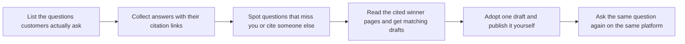
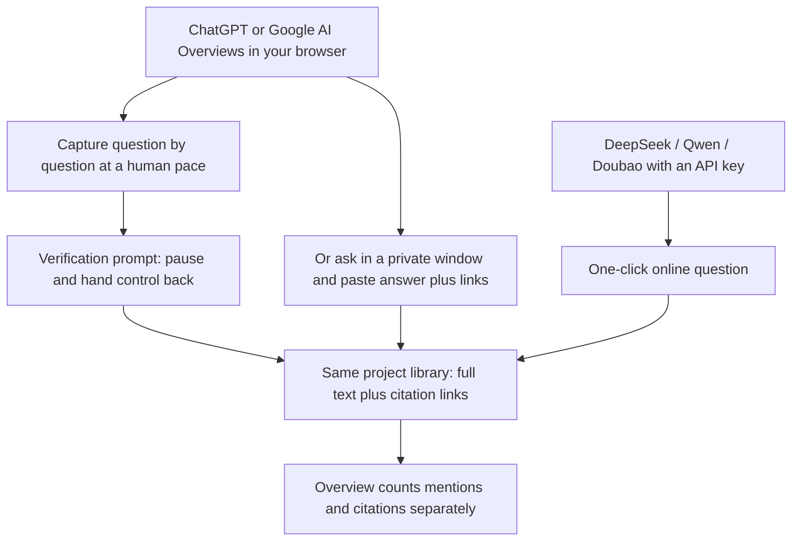
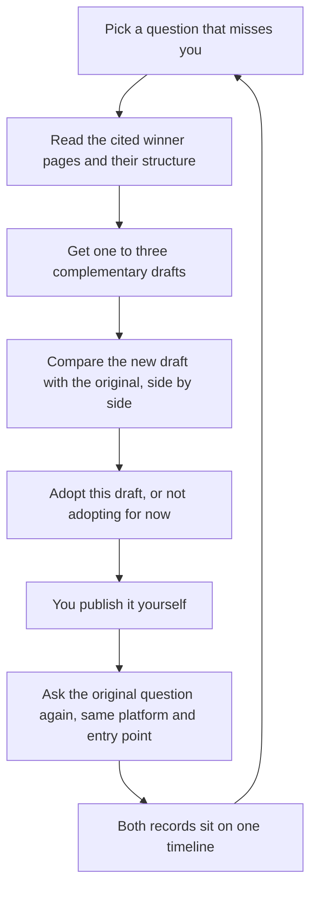

# Getting Started: Run OpenGEO Locally and Capture Your First ChatGPT + Google AI Overview Answers

[简体中文](getting-started.zh-CN.md)

Ask ChatGPT or Google AI Overviews which tools track brand visibility in AI answers, and you get a tidy list — Otterly, Peec AI, Profound, Ahrefs, Semrush — with their pages cited underneath. Your own repository is not in that answer, and nothing in your docs tells those assistants what you actually do.

That gap keeps working against you. Buyers who used to scroll a results page now ask an assistant and act on the first three names it returns, and the pages those models have already read are the pages that get quoted. Running the questions yourself, keeping the real answers, and fixing the pages that lose is how you get into that set.

This guide takes you from a fresh install to a first recorded round. By the end you will have a project built from your public links, real ChatGPT and Google AI Overview answers stored with their citation links, a read of the winner pages behind the questions that miss you, and a retest of the original question once a draft goes live.

## How it works

OpenGEO is a local workbench for one loop: ask the questions your customers ask AI search, keep the full answer and the pages it cited, find the questions where you are missing, and get a draft written for each gap. It runs on your own machine — the project profile, saved answers, and the keys you enter stay in local files and never leave your computer.

Four things to recognise before you click anything:

| Concept | What it is | Why you need it |
| --- | --- | --- |
| Your project profile | Your public homepage or repository page, plus a few sentences on who you serve and how you differ | The workbench reads it to understand your product; question generation and draft writing both depend on it |
| Customer questions | The phrases a buyer would type into an AI to find something like yours, compare alternatives, or look you up by name | One fixed list is what makes before-and-after answers comparable |
| Answer evidence | The full answer text saved after each question, plus the reference pages shown under it | You check conclusions against the original text instead of your memory |
| Winner breakdown, matching drafts, retest | A read of the externally cited pages that beat you, the draft written against them, and the same question asked again after you publish | Each change maps to something you can actually observe |

The loop in three moves: **create a project → collect and compare answers → break down the winners, adopt a draft, retest with the original question.**

A first round takes 30 to 60 minutes, and you do not need dozens of questions to start.

## 1 · Launch the workbench and create a project

The quickest way to get the UI open is to hand the repository to the AI coding assistant you already use — Claude Code, Cursor, Codex and Antigravity all work. Paste `https://github.com/cooleryu/opengeo` and say: "follow the repo instructions, run it on my machine, and open the UI for me." It installs the dependencies, starts the local service, and gives you an address to open in your browser.

From there you stay in the browser. The first screen is the new-project form, and it asks for three things:

1. **Display language: English or Chinese.** Set it at the top of the form. Every analysis report, draft and UI label follows that choice afterwards, so pick the language you want to read results in.
2. **Project type: open-source project, or software or website.** This only changes how the generated questions are worded and angled — nothing else. You can change it later.
3. **A public link and a few sentences of positioning.** Your homepage, repository page or product site all work. Then describe who uses it, what problem it solves, and what makes it stronger than the alternatives. Those sentences drive everything downstream, so two minutes here pays for itself.

Click **Start analysis**. It reads the public pages it can reach and shows you what it understood, then derives up to 8 core questions from a buyer's point of view: a direct brand search, a category recommendation, a specific scenario need, and a competitor comparison. Read them, cut what does not fit, and add a phrase customers have actually said to you. You never start from a blank page.

Pages behind a login cannot be read. The project stays in your list, so retry with a publicly reachable URL.

When the project is created you land on **Overview**, which answers two things only: do these answers mention you, and do the cited links include your domain. Mentions and citations are counted separately — being named in the prose and being cited as a source are different wins, and the workbench keeps them apart.

Prefer to start from a terminal? (developer option)

Full setup steps live in the Quick Start section of [the README](../README.md). You need Node.js 24; the service then runs locally on port 4327. Leave any missing API keys blank during setup and add them in the UI later.

## 2 · Connect services and collect real answers

Open **Settings** and fill in what you already have. Two separate things live there: the model service that reads your product, audits saved answers and writes drafts; and the platforms you collect answers from. One working provider is enough for the first round.

| What you want to collect | How OpenGEO gets it | What you can check afterwards |
| --- | --- | --- |
| ChatGPT answers | Capture from your own browser session, one question at a time at a human pace; or ask in a private window and paste the answer text plus the links shown under it | The full answer, every link it listed, and whether your domain is among them |
| Google AI Overviews | Same two paths, recorded against the same question list | Whether the overview names you, and which sites the source panel points to |
| DeepSeek / Qwen / Doubao (optional) | Add the provider key, then run questions from the list with one click | The full answer plus the cited pages the provider returns |

Browser capture works inside your own logged-in session, so the answer you save is the answer a real person gets — not a server-side approximation. When a platform shows a verification prompt, capture stops and hands control back to you instead of trying to slip past it; nothing in the workbench works around those checks. If you would rather not run capture at all, ask the question in a private window and paste the full answer and its links into the matching record. Both paths land in the same project library.

When you paste, paste the whole answer and every link, not the one sentence you liked. Every later judgement about "did it cite me?" is checked against that saved text and that link list.

**Optional: pick one main competitor to compare.** Same question set, same platform, side by side. That immediately separates two very different situations — nobody in your category got mentioned for this question at all, or a specific competitor page was cited while yours was ignored. The first means you need content that answers the question; the second means you should study the angle they wrote from.

For the first pass, run the questions the workbench already prepared (up to 8) on one or two platforms you actually care about. That is enough to see the direction: which questions name you, which cite a competitor comparison page, which return no link to your site at all.

## 3 · Break down the winners, review each draft, and retest with the original question

Open **Improvements & Tracking** for a question where you are missing — a category recommendation that lists three competitors, or an answer that quotes someone else's comparison post. OpenGEO first probes the pages the AI actually cited for that question and reads their skeleton: the headings they use, what they answer in the first two sentences, which dimensions they compare. A summary of those reference winners sits at the top of the page, so you know what you are up against before you read a single draft.

It then writes one to three complementary drafts for that question — typically a README front page, a getting-started guide, and a public comparison or hands-on article — rather than restating the same point three ways. Each draft opens as **new draft against original text**, and each passes an independent review before it reaches you, so you are editing something publishable instead of a pile of suggestions.

Nothing gets pushed out in bulk. If a draft fits, click **Adopt this draft**. If you want to wait, click **Not adopting for now** and come back later. Publishing itself stays with you: the workbench never writes to your repository or your live site.

Once the content is live, ask the original question again — same platform, same entry point, same wording — and open both records on one timeline. You are comparing your own two answers, not guessing across sources.

## Cost and local data

Four things hold true however you use it.

- Browsing past answers, adjusting settings and reading drafts costs nothing. No request leaves your machine until you start something.
- Requests go out only when you trigger them: project analysis, an online question, draft generation, a retest. Those calls hit the accounts you configured and are billed by that provider at their own rates. A question asked once is one call, and an idle workbench does not keep spending.
- API keys, login state and the project database live in local files on your computer, not on anyone's server. Keep those files out of public commits.
- Stopping the local service loses nothing. Start it again and continue where you stopped; with the service down, the UI simply will not open.

## Frequently asked questions

### Can I collect ChatGPT and Google AI Overview answers without buying a search API?

Yes. Those two platforms are recorded from your own browser session, or from a private window where you paste the answer and its links back — no search API involved. What the workbench does need is an analysis model key you already have, since that is what reads your profile, audits saved answers and writes drafts. With no key at all you can still store answers and read them yourself; only the automatic analysis and drafting wait.

### Do I have to invent the monitoring questions myself?

No. Creating a project reads your public links, works out what your product is, and derives the question set for you: a direct brand search, a category recommendation, a specific scenario need, and a competitor comparison, narrowed down to at most 8 core questions. Review them, delete the ones that do not sound like your buyers, or add a sentence a customer actually said to you.

### Why does an API answer look different from what I see on the web or in the mobile app?

This is normal. Retrieval settings, the number of results pulled in, memory and personalisation differ between API endpoints and consumer apps, so the same model can legitimately answer differently through different doors. Compare one entry point before and after a change; comparing an API answer against a mobile-app answer gives you a difference that has nothing to do with your content.

### How should I choose between OpenGEO, paid monthly SaaS, and other open-source monitors?

They overlap on watching, and diverge on what happens after you see the number. Pick by team size, budget, and whether you need a dashboard to report or a draft to ship.

| | Asking AI by hand plus a spreadsheet | Paid monthly SaaS (Otterly.AI, Peec AI, Profound) | Monitoring-only open source (Elmo, Gego, Limelit Open) | OpenGEO local workbench |
| --- | --- | --- | --- | --- |
| Cost | Free, costs your time | Monthly subscription, usually scaled by questions and engines | Free software, you host and maintain it | Open source and free; you pay only your own model and search usage |
| Who runs collection | You, by hand, whenever you remember | The vendor, on a schedule, while your laptop is closed | Your server or CLI | Your machine, whenever you start the service |
| What gets captured | Whatever you bothered to paste | ChatGPT, Google AI Overviews, AI Mode, Gemini, Claude, Perplexity, Copilot and more, where supported | Scheduled prompts across several engines, with citations and mentions captured | ChatGPT and Google AI Overviews from your own browser; DeepSeek, Qwen and Doubao through their APIs |
| What you get out | A pile of rows and your own judgement | Dashboards, share of voice, trend lines, weekly reports | Mention and citation counts in a hosted dashboard | Full answer text with citation links, a winner breakdown, a draft per gap, and a same-question retest |
| Where the data lives | Your laptop | The vendor's servers | Your own infrastructure | Your own laptop |
| Best fit | A first rough gut check | Teams that need scheduled reports and wide engine coverage | Teams that want raw tracking data on infrastructure they control | Teams that want to know which page to fix next week and get the draft written along the way |

The two sides also work together fine: a paid platform for scheduled trend reporting, this workbench for first-hand answers, the cited pages behind them, and the draft you actually ship.

### After I ship the doc or publish the article, how long should I wait before retesting?

Longer than feels natural. Search engines and model crawlers need time to pick up and re-read a page, so a retest a few minutes after publishing usually returns the old answer and tells you nothing. Give it days rather than minutes. If several rounds still show no change, open the citation list for that question before rewriting anything: you may have edited a page the model never cites, while the answer was quoting a third-party review or a comparison post the whole time.

### Will OpenGEO publish anything for me?

No. Drafts stay drafts until you copy them into your repository, your docs or your blog. It writes nothing to your live content and posts nothing anywhere, which also means the publish step is where your judgement enters — read the draft, keep what is true about your product, and cut the rest.

Stuck on a step? Open an issue with the saved answer or a screenshot and it gets much easier to pin down: `https://github.com/cooleryu/opengeo/issues/new`.
