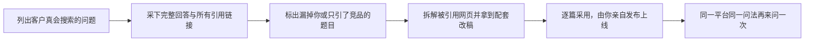
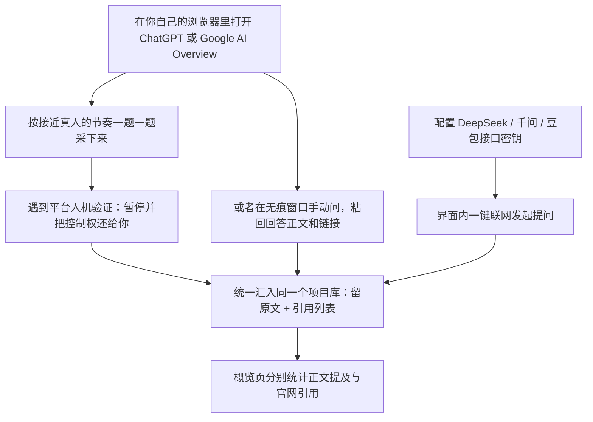
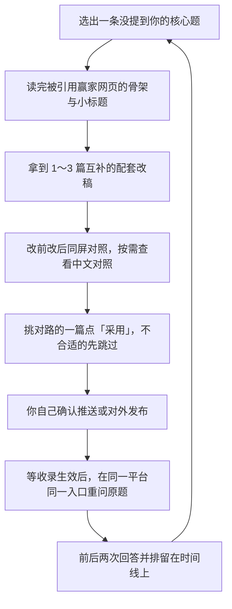

# 快速上手：在本地跑起 OpenGEO，采下第一批 ChatGPT 与 Google AI Overview 真实回答

> **语言 / Language**：简体中文 · [English](getting-started.md)

你在 ChatGPT 或 Google AI Overview 里搜一句「哪些开源工具可以监测 AI 搜索里的品牌露出？」，回答常常会干净利落地列出一串名字——Otterly、Peec AI、Profound、Ahrefs、Semrush——底下再附上它们的页面链接。你自己的仓库并不在名单里，文档首页也没有把你是谁、解决什么问题写到模型能读懂的位置。

这个缺口会一直帮竞品拦流量。以前用户还会一页页翻搜索结果，现在很多人直接问 AI、看前三名就拍板，而模型手里读过哪几页公开文档，决定的就是谁被推荐。把客户真会打的那几句话自己问一遍、把回答原文和引用链接收齐、再去改输掉的那几页，就是把品牌放进候选池的办法。

这篇上手指南带你从装好工具一路走到第一次复测：读公开链接建项目、锁定界面语言、在本地浏览器采下真实 ChatGPT 与 Google 回答、拆解赢家页面结构，并把写好的配套改稿推上线再复查。

## 整体怎么运作

OpenGEO 是一套本地运行的工作台，只围绕一条闭环运转：把客户常问的问题问一遍，原样存下回答和它引用的网页，找出你漏掉的问题，然后针对每个缺口生成配套改稿。所有项目资料、保存下来的回答、以及你自己填的密钥全部存在本地文件里，不离开你的电脑。

动手前先认识四个页面里会反复出现的词：

| 概念 | 它是什么 | 为什么需要它 |
| --- | --- | --- |
| 项目资料 | 你的公开首页或仓库地址，加上几句受众与差异化说明 | 工作台读它来理解你的产品，出题和改稿都依赖这一步 |
| 客户常问问题 | 潜在买家会在 AI 里怎么找同类工具、比竞品或直搜你的名字 | 固定同一张问题清单，改动前后对比才成立 |
| 回答证据 | 问完保存的完整回答正文，加上底层挂载的参考网页链接 | 结论都能回到原文逐字核对，不再凭模糊印象判断 |
| 赢家拆解、改稿与复测 | 读取并拆解排在你前面被引用的网页结构，据此写出新稿，发布后回同一题重问 | 每次改动都对应一个能亲自观测到的变化 |

整条回路只有三步：**建好项目 -> 采集并对比回答 -> 拆解赢家、挑稿上线、再用原题复测。**

## 1 · 启动工作台并创建项目

最快打开界面的方式，是把仓库地址交给手边已在用的 AI 编程助手（Claude Code、Cursor、Codex、Antigravity 都可以）。直接把 `https://github.com/cooleryu/opengeo` 发给它，跟它说：「按仓库里的说明帮我在本地跑起来并打开界面。」它会替你装好依赖、启动本地服务，并给出访问地址。

从这一刻起，所有操作都在浏览器界面里完成。第一屏是新建项目表单，只需要填三样东西：

1. **先把表单最顶部的界面语言选好：中文或英文。** 后面的问题推导、回答审核说明、以及优化方案与改稿的展示都会对齐这个选择。如果平时团队习惯看中文界面、但想针对海外读者优化英文文档，也可以保持中文界面，工作台支持在生成英文原稿时一并生成「中文对照版」。
2. **选定项目类型：「开源项目」或者「软件或网站」。** 它只影响后续生成提问时的切入角度，选错了随时也能改。
3. **贴入公开链接并写几句产品定位。** 官网、GitHub 仓库首页或产品介绍页都行；再简单写清谁在用、解决什么问题、和同类方案比赢在哪一处。花两分钟写准这几句，后面每一步都会省很多劲。

点下 **开始分析**，工作台会沿着能公开访问的页面读一遍，列出它对你的理解，并站在真实买家的角度推导出最多 8 道核心问题，覆盖直搜品牌名、品类选型、场景用法与竞品比较。看一遍清单，不合适的删掉，再补一两句客户平时真问过你的原话，你不用对着空白页面硬想。

需要登录才能看的链接读不到，但建到一半的项目会留着，换一个公开可读的网址重试就行。

建完即跳到 **概览** 页。这一页只负责摊清两件事：AI 回答里提到了你吗？参考来源里挂上了你官网或仓库链接吗？「提及」和「引用」分开计数——正文点出名字与附上官方网站来源是两件不同的事，工作台不会把它们揉成一个模糊分数。

*真实概览界面 · 品牌提及与官网引用分开呈现，中间卡片直观汇总当前最需要处理的改进突破口*

习惯自己在终端启动？（开发者可选）

完整安装与环境变量步骤在 [仓库 README](../README.zh-CN.md) 的「快速开始」一节。本机需要 Node.js 24，本地服务启动在 `4327` 端口。首次配置时手头还没有的 API Key 可以先留空，进界面后再慢慢补。

## 2 · 连好模型与平台，采下第一批真实回答

点开右上角 **设置**，把你手头已经有的密钥填进去。这里分两类配置：一类是用来理解你的产品、核对回答原文并起草改稿的模型接口；另一类是你用来跑问答的 AI 平台。跑第一轮时，先配好一个可用模型就已经够用。

| 你想采哪家平台 | OpenGEO 怎么拿回答 | 采完后你能看到什么 |
| --- | --- | --- |
| ChatGPT 回答 | 在你自己的已登录浏览器会话里按接近真人的节奏逐题提问并记录；或者自己在无痕窗口问完，把回答正文和引用网页原封不动粘回来 | 完整回答全文、挂出来的参考网站清单，以及有没有提到或引到你 |
| Google AI Overview | 同样的两条路，归在同一批核心题底下 | 概览片段里点名了谁，右侧来源卡片指向了哪些外部站点 |
| DeepSeek / 千问 / 豆包（可选） | 填好各自平台密钥后，直接在题单里一键提问 | 完整回答原文，以及服务商返回的全部参考网页链接 |

浏览器采集走的是你本机已登录的真实会话，因此存下来的就是普通登录用户当时眼见为实的画面，而不是服务器 API 的另一套模型快照。要是中途碰到平台弹出人机验证，采集中断后控制权直接交还给你本人去点过，工作台绝不做任何绕过校验的黑箱脚本。如果你不想跑自动浏览，也随时可以开无痕窗口手动提问再粘回记录里，两条路都会汇进同一本台账。

手动粘贴时务必连正文带全部参考链接一块儿粘进来，别只截其中合心意的一句——后面判断「到底算不算提到我、有没有引用我的网页」全部依赖那份完整记录。

**可选但很管用：挑一个主要竞品对照。** 同样的题单、同一个平台并排放在一起，立刻就能区分出两种完全不同的处境——要么这道题下整个品类谁也没上榜，要么竞品某一篇对比文或文档被模型当成了唯一依据而你完全被跳过。前者意味着缺基础内容，后者直接指明了别人写对了什么结构。

*回答详情抽屉 · 从概览点进任意问题，就能把该题在不同平台的真实回答和被提名的竞品摆在手边核对*

第一轮跑一遍建项时备好的核心题（最多 8 道），挑一两个你的目标客户最常用的平台就足够看清方向：哪些题里其实提了同类却没提你，哪些题干脆把同名的别人当成了你。

## 3 · 拆解赢家页面，逐篇审阅改稿，再用原题复测

遇到关键问题没提你——比如选型推荐里列了一排开源竞品、偏偏没有你的仓库——切到 **改进与追踪**。动手写稿之前，OpenGEO 会先去探测那些真被 AI 引用的赢家网页，把它们的骨架摊给你看：用什么 H2 小标题、前两句先答了什么、比对表格列了哪几个维度。那串引用来源与骨架摘要就挂在方案顶部，动笔前就能看清对手赢在哪里。

接着它会针对短板一次备好 1～3 篇角度互补的配套改稿——通常是一篇首页 README 改写、一篇快速上手指南、外加一篇可直接发在外部社区的实操长文——而不是换着法儿重复同一段推销词。每篇都能点看 **修改后新稿** 与 **改前原文** 的差异；如果你开启了「同时生成中文对照版」，正文上方还能随时在英文原稿与中文对照之间切换阅读，甚至直接复制中文版本去中文平台发布。每份方案交付前都会过一轮针对真实性、边界与可读性的核验。

工作台不会把改稿偷偷推上网。觉得合用就点 **采用这一篇**；想先放一放，点 **这篇暂不采用** 就行。哪怕改稿已经采纳到本机，在你主动点击推送或亲自对外发布之前，你的线上仓库与页面都不会被改动一分。

内容上线之后，挑一个星期回来用同一个平台、同一个入口、同一字不差的原题再问一次，让改动前后的两份记录坐在同一条时间线上对比效果。

*改进与追踪工作室 · 既能在审阅英语原稿时一键打开中文对照，也能对照修改前后文本逐篇拍板*

## 费用与本地数据

用多久都有四条边界始终成立：

- 平时打开工作台看历史回答、改界面设置、阅读已生成的改稿都不收费，没有请求会在你没点按钮时偷偷发出去。
- 只有你主动触发「产品分析」「联网提问」「生成改进方案」或「原题复测」时，工作台才用你填写的模型或搜索密钥发请求，费用直接由服务商按你选的模型计费；问一道扣一道，放着不动不产生账单。
- 接口密钥、浏览器登录会话和所有项目数据库全放在你电脑本机目录里，不会上传到我们的服务器；注意别把本地数据文件意外提交进公开 Git 仓库。
- 关停本地服务不会丢任何数据，下次启动还是上次停下的地方；服务没启动时页面打不开而已。

## 常见问题

### 不买第三方搜索 API，也能先把 ChatGPT 和 Google AI Overview 测起来吗？

可以。这两家的回答都支持在自己的浏览器会话里采集，或者用无痕窗口自己问完再把全文和链接贴回工作台，不依赖搜索 API。你真正需要准备的是一枚常用大模型 API Key，因为分析项目资料、审计回答里有没有提及品牌、以及写配套改稿都需要调用模型；如果一颗 Key 都不填，你依然可以把收集到的回答存在本地逐条对照。

### 监测的问题清单必须全部自己绞尽脑汁想吗？

不用。建项目时工作台顺着你的公开网页读完产品定位，会自动推导出品牌直搜、品类选型、场景用法、竞品对比这四类共最多 8 道核心题。你只需要把不像买家口吻的题划掉，再补充几句老客户真问过你的原话就行。

### 为什么用 API 跑出来的回答，和我平时在网页或手机 App 上看到的不太一样？

这很常见。接口调用和消费端 App 在联网开关、召回网页数量、账号历史记忆与个性化参数上本来就不同，同一个模型在不同入口往往给出两套参考链接。想验证一次文档改写有没有效，关键在于**同一个入口前后纵向比**：改前用浏览器、改后还用同一条浏览路径重测，千万不要拿 API 回答去对比手机 App 回答。

### 它和付费按月监测 SaaS、或者其他开源监测项目怎么选？

大家在「看现状」这一段有重叠，分歧发生在「看到数字之后怎么办」。按团队预算、要不要每周发周报、以及是想看走势还是想直接拿改稿来决定就好：

| 对比维度 | 手工提问 + 电子表格 | 付费云端监测 SaaS（Otterly.AI、Peec AI、Profound） | 纯监测型开源工具（Elmo、Gego、Limelit Open） | OpenGEO 本地工作台 |
| --- | --- | --- | --- | --- |
| 使用成本 | 免费，花你的时间 | 按月订阅，通常随题量与引擎数量阶梯收费 | 开源免费，需要自己搭服务器运维 | 开源免费，只付自己账号下调用模型与搜索的用量 |
| 谁跑采集 | 你想起来时手动问 | 供应商定时后台扫，关掉电脑也能跑 | 你部署好的服务器或 CLI | 你开本地界面或执行任务时在你的电脑上跑 |
| 覆盖入口 | 你手动打开哪家就看哪家 | 覆盖多家海外 AI 引擎（按套餐支持情况） | 主要通过接口定时跑几家 LLM 引擎 | 本地浏览器采 ChatGPT 与 Google AI Overview，接口可接 DeepSeek、千问、豆包 |
| 最终拿到手的是什么 | 一堆零散表格与自己记忆 | 可视化趋势图、声量占比与每周汇总报告 | 自托管看板里的提及次数与引用统计 | 回答原文与来源 URL、赢家网页结构拆解、配套改稿及同题复测记录 |
| 数据放在哪 | 你的笔记本上 | 供应商云端服务器 | 你自己的服务器 | 你自己的电脑本机 |
| 最适合谁 | 刚想摸一次底的个人开发者 | 需要每周向外汇报声量走势、人手不够的营销团队 | 想要在自有设施里持续跑监控、看指标的工程团队 | 想直接知道下周改哪页、并拿现成改稿亲自发布的独立产品团队与文档作者 |

两类工具并不互斥：需要大盘周报时可用云端看板看趋势，需要看第一手回答、拆解高排名参考页并拿出可直接改的稿子时，在本地用 OpenGEO 就够了。

### 新内容发出去以后，过多久回来复测比较合理？

比想象中要耐心一点。搜索引擎重抓与大模型索引更新都需要时间，发完不到十分钟立刻回去重测，大概率拿到的还是原来的缓存答案。通常留出几天到一两周再回来看更稳。如果隔了几轮还是没变动，重改之前先点开那道题底下的引用网页清单：很多时候你改的是自己官网首页，但 AI 回答从头到尾都在引另一篇第三方博客对比帖。

### OpenGEO 会替我自动把文章或文档发上网吗？

不会。每篇改稿在你不点击「采用」并确认推送、或者自己复制发到博客之前，都只是保存在你本地数据库里的草稿。这样最后上线那一关的事实准确性始终握在你自己手里。

使用中在哪一步卡住了？带上一份保存的回答或截图在这里提一条 issue 会很快定位：`https://github.com/cooleryu/opengeo/issues/new`。
