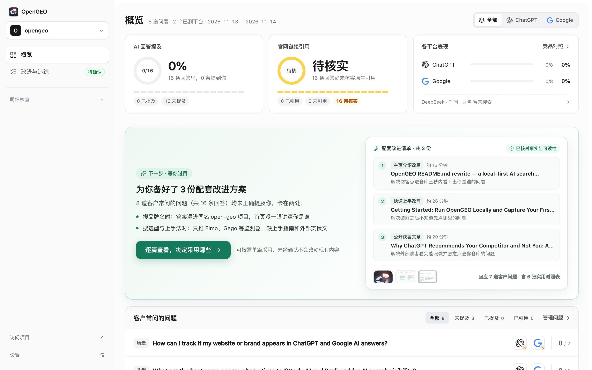
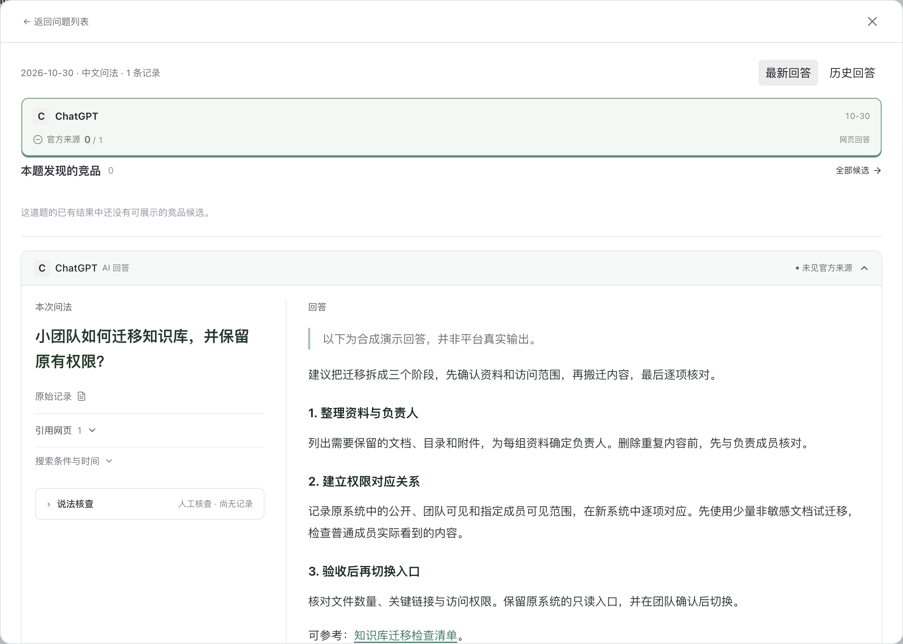
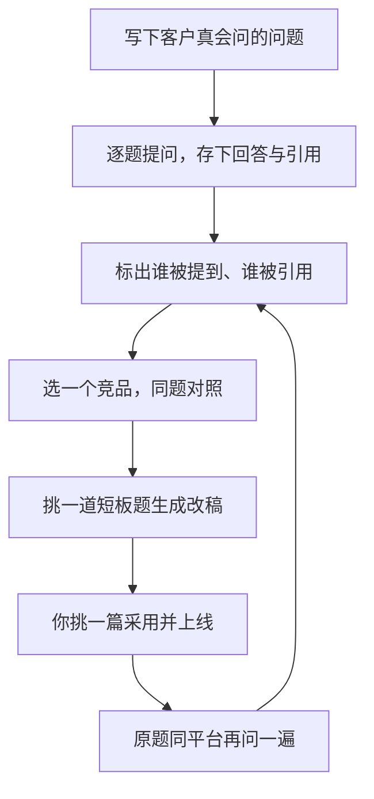
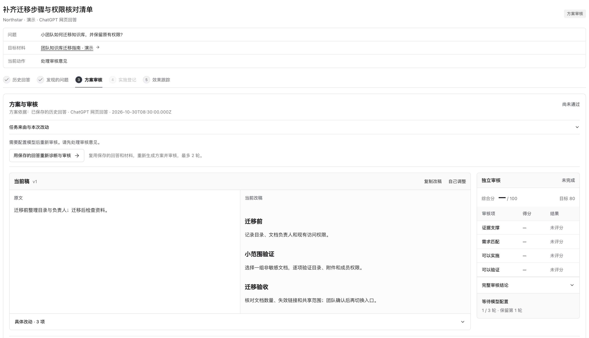

# 快速上手指南

> **语言 / Language**：简体中文 · [English](getting-started.md)

你在 ChatGPT、DeepSeek、豆包这些 AI 搜索里问一句和生意相关的话，回答会顺口列出几个产品、几篇网页。你的产品在不在里面、它引的是你官网还是竞品那篇对比文——平时没人替你看，自己问也容易被登录状态、记忆和个性化带偏。

OpenGEO 就是把这件事固定下来：把你客户真会打的那几句话存成一张清单，一条条问，把完整回答和回答底下挂出来的链接原样留档，标出这次谁被提到了、谁的内容被引用了，再针对最该改的那道题写一段能直接发布的稿子。它在你自己的电脑上跑，项目资料、回答记录、接口密钥都放在本机目录，不经过我们的服务器。

## 整体思路

先把四个词对上号，后面每一步你都知道自己在看什么。

| 概念 | 它是什么 | 你怎么用它 |
| --- | --- | --- |
| 你的项目资料 | 公开官网或仓库主页，加上几句补充介绍（写给谁、解决什么问题、比同类强在哪） | 让它读得懂你的产品，出题和改稿都靠这份理解 |
| 客户常问问题 | 潜在买家会在 AI 里怎么打字找同类产品、比竞品、或者直搜你名字 | 一份清单反复用，改动前后才有可比性 |
| 回答留证 | 每次问完存下来的完整回答原文，以及回答底下挂出的参考网页 | 结论能一条条回到原文核对，不用凭印象吵架 |
| 配套改稿与复测 | 按短板写好的可发布内容，你挑着采用上线，再用原题问一遍 | 一条改动对应一个可观察的变化 |

三步闭环，一句话就是：**新建项目建档 → 采集并对比回答 → 挑合适改稿上线后复测**。

一轮完整的检查，通常半小时到一小时能走完，不用一上手就铺几十道题。

## 1 · 启动工作台并新建项目

最省事的启动方式：把仓库地址发给你平时用的 AI 编程助手（Claude Code、Cursor、Codex 都行），跟它说一句「按仓库里的说明帮我在本地装好并打开界面」。仓库地址是：

`https://github.com/cooleryu/opengeo`

它会自己读说明、装好依赖、起服务，最后给你一个本地地址，浏览器打开就是工作台。中间它问你的问题，照实答就行，不需要你懂命令行。

习惯自己在终端启动（开发者可选）

仓库 README 的「开始使用」一节有完整命令，本机需要能跑 Node.js 24 与 npm。按顺序执行完，浏览器访问 `http://127.0.0.1:4327` 就是界面。环境变量模板在那一步一起复制出来，缺哪个密钥都先空着，之后在界面上补。

第一次打开是新建项目页，三步：

1. **选类型**：开源项目 / 电商店铺 / 公司或产品 / 自媒体。类型只影响它出题的语感，选错了也能改。
2. **填公开链接**：官网、仓库主页或店铺页都行。再补几句产品定位——谁在用、解决什么问题、和同类比强在哪。这三句直接影响它后面怎么理解你，值得多写两行。
3. **点「开始分析」**：它会顺着公开页面读一遍，先给你看它理解成了什么，同时自动站在潜在买家视角推导并筛出最多 8 道核心问题。理解有偏差或想补两句平时常被问到的原话都能直接改，不用自己对着空白页凑题。

有些页面要登录才看得到，读不到的项目会保留下来，换个能公开访问的链接重试就好。

建完就落到「概览」页。这一页只回答两件事：AI 回答里提到你没有，回答底下的参考链接里有没有你的站点。

*截图里是一个演示项目，你自己新建的项目数字从零开始。*

## 2 · 连接服务并采集真实回答

点开「设置」，填你手里已经有账号的模型或搜索接口密钥。这里没什么必须全配的压力，先配一个能用的就够跑第一轮。

| 平台 | 怎么拿到回答 | 你会看到什么 |
| --- | --- | --- |
| DeepSeek / 千问 / 豆包 | 填上接口密钥，在问题列表里一键提问 | 完整回答正文，以及平台返回的来源链接 |
| ChatGPT / Google 的 AI 回答 | 不搞绕过高风险的抓包；用无痕窗口自己问，把回答正文和参考网页粘进对应问题 | 和接口结果记在同一本账里，一起统计提及和引用 |

两类结果进的是同一个项目，概览上的数字是合在一起算的。粘贴的时候尽量整段原文带过来，别只摘一句——后面判断「有没有引用我」靠的就是这些原文和链接。

**可选：选一个主要竞品对照。** 同一批问题、同一个平台并排看，能立刻分辨出两件完全不同的事：是这道题整个品类里谁都没提你，还是竞品某一篇页面被引用了而你没有。前者要补内容，后者要看清它写的是什么角度。

*截图内为演示数据。*

跑完一轮，新增的回答会直接进概览。第一次直接跑建项时自动备好的这批核心问题（最多 8 道）、先选一两个常用平台把方向看出来就行，别急着一次铺满。

## 3 · 逐篇审阅改稿与原题复测

在概览看到明确的短板（比如「品类推荐那几题都没提你，回答引了三篇竞品对比文」），点进「改进与追踪」。顶部会列出几篇互补的方案：一篇给官网补一页讲清事实的页面，一篇写第三方视角的对比内容，你可以只挑其中一篇。每篇都能展开看「修改后新稿」和「修改前原文」的对照。

改稿不绑架你一次全发：觉得这篇合适就点「采用这一篇」，暂时不想动就点「这篇暂不采用」，过两周回来再看也行。

内容上线后，回到同一道题，用同一个平台、同一个入口再问一遍，两次回答并排放在一起，改动前后的差别不用猜。

*截图内为演示数据。*

## 费用与本地数据

- 翻看历史回答、改设置、读改稿，都不花钱。
- 只有你主动点产品分析、联网提问、生成改稿、原题复测时，工作台才用你自己填的密钥向对应服务发请求，按服务商的官方价格扣，账单在你自己账号里。一道题问一次，花的就是一次问答的钱，不会因为放着不动持续增长。
- 密钥、登录状态、项目数据库都在你本机目录里，不经过我们的服务器。注意别把这些文件提交到公开仓库。
- 关掉本地服务数据不会丢，下次启动接着看；服务没开的时候，界面也就打不开。

## 常见问题

### 一个密钥都没配，能先试用吗？

能。ChatGPT 和 Google 这两条路本来就是手工提问、粘贴存证，不配任何密钥也能把第一批回答记下来，做提及和引用的核对分析。需要配密钥的是三件事：让 DeepSeek、千问、豆包在界面里一键跑，让模型读懂你的项目资料，以及自动生成改稿。

### 同样的题，接口跑出来的答案和我在手机 App 里问的不一样？

常见。各家接口的检索开关、结果条数、记忆和个性化设置，跟消费端 App 不是一套参数，同一个模型在两个入口给出的答案本来就可能有出入。所以最有参考价值的是纵向对照：同一道题、同一个入口、改动前后各问一次。跨入口比数字容易得出错误结论。

### 它和 Peec、Otterly、Ahrefs 这类按月付费的监测工具怎么选？

两类东西解决的是同一件事的两半：线上平台帮你盯趋势，本地工作台帮你把结论变成能发布的内容。按团队情况挑就行。

| 对比项 | 自己在 AI 里手工问 + 抄表格 | 线上按月付费的监测平台（Peec AI / Otterly.AI / Ahrefs Brand Radar / Semrush 等） | OpenGEO 本地工作台 |
| --- | --- | --- | --- |
| 花钱 | 0，只花你的时间 | 一般每月几十到上百美元，按题目数和平台数算 | 开源免费，只付你自己模型和搜索接口的调用费 |
| 谁来跑 | 你自己，靠记得 | 平台定时自动跑，电脑不用开 | 你打开本地服务时跑，或按你设的每日计划跑 |
| 平台覆盖 | 想问哪个问哪个 | 海外平台（ChatGPT、Gemini、Perplexity 等）覆盖更成熟 | 豆包、千问、DeepSeek 走接口一键问；ChatGPT、Google 手工存 |
| 产出物 | 一堆表格，判断靠人 | 看板、声量份额、趋势图 | 完整回答原文 + 引用链接 + 单题改稿 + 同题复测 |
| 数据在哪 | 你的电脑 | 平台服务器 | 你的电脑 |
| 适合谁 | 只想先摸个底 | 团队要固定节奏的周报日报、要多平台铺开 | 想把结论落成具体内容改动、愿意自己跑本地服务 |

有个坑提前说：国内的豆包、千问、DeepSeek 和海外那几家不能互相替代。用户群不同，检索到的网页来源也不同，只盯海外平台得出的结论，搬到国内场景常常不成立。你的客户主要用哪边，问题清单就往哪边站。两类工具也可以一起用：线上平台看趋势，工作台拿一手回答、出改稿。

### 监测问题需要我自己一道道想吗？

不用。新建项目时，工作台顺着公开链接读懂你的产品后，会自动推导出直搜品牌名、品类推荐、具体场景需求、竞品对比这四类问法，并精选出最多 8 道最有代表性的核心问题。你只需要看一眼确认，或者把平时客户常问你的那两句原话顺手补进去就行。

### 同一道题隔天再问，结论不一样，是我操作错了吗？

不是。AI 搜索本身有波动，检索到的页面、排序、模型版本每天都可能变，单次回答只能代表那一刻。所以比单次结果更值得看的是趋势：同一道题在同一个入口连续几轮有没有稳定表现。如果只问了一次就下结论，很容易被一次偶然带跑。

### 改稿上线了，AI 回答还是没提到我，算白做了吗？

先别急，也别只看一次。搜索引擎收录和模型抓取都需要时间，刚贴完几分钟就复测，看到的还是旧结果。等几天到两周再按原题问一遍更合理。如果几轮都没有变化，通常是改动没覆盖到真正被引的那个页面——回答引的是第三方评测站，而你改的是官网，这种情况在工作台的引用列表里能直接看出来。把它当成下一轮的线索，而不是失败记录。

卡住的地方可以直接在仓库的 Issues 里说一声：`https://github.com/cooleryu/opengeo/issues/new`。
